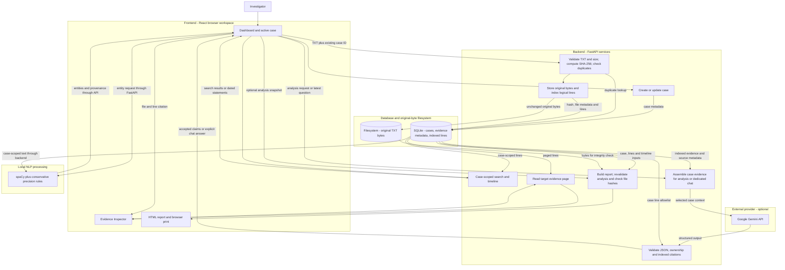
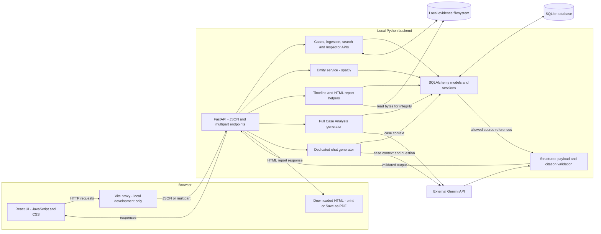
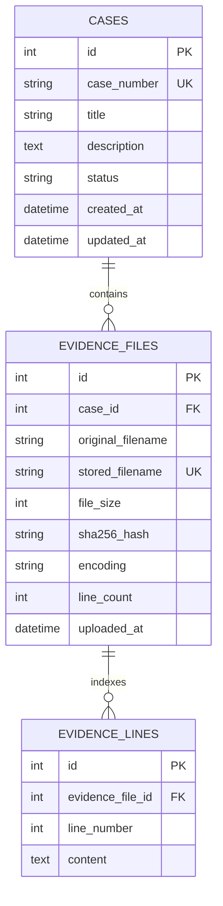

# ChronicleAI

**A local, evidence-first investigation workspace for text-based digital records.**

ChronicleAI combines a React investigation dashboard with a FastAPI backend to organize cases, preserve uploaded text evidence, search indexed lines, explore named entities, and build source-linked timelines. Optional Google Gemini analysis and a floating case chatbot produce cited output that can be checked in the Evidence Inspector. The project is a college-presentation and developer-portfolio MVP: its central distinction is **original evidence, statements about evidence, and investigative interpretations are different things**.

## Quick Start

Follow [Installation and startup](#installation-and-startup) for the verified Windows PowerShell setup: clone the presentation branch, install backend dependencies and the spaCy model, choose data paths, then start FastAPI and Vite in separate terminals. Gemini access is optional for the local investigation tools; configure a key to use analysis and chat.

**Explore:** [How it works](#how-chronicleai-works) · [Investigation guide](#usage-guide) · [API reference](#api-reference) · [Testing](#testing-and-verification) · [Screenshots](#screenshots)

## Contents

- [Overview](#overview)
- [Key features](#key-features)
- [Technology stack and design rationale](#technology-stack-and-design-rationale)
- [How ChronicleAI works](#how-chronicleai-works)
- [Investigation workflow](#investigation-workflow)
- [System architecture](#system-architecture)
- [Database design](#database-design)
- [Module workflows](#module-workflows)
- [Prerequisites](#prerequisites)
- [Installation and startup](#installation-and-startup)
- [Environment configuration](#environment-configuration)
- [Usage guide](#usage-guide)
- [API reference](#api-reference)
- [Testing and verification](#testing-and-verification)
- [Project structure](#project-structure)
- [Screenshots](#screenshots)
- [Limitations and future work](#limitations-and-future-work)
- [Troubleshooting](#troubleshooting)
- [License and authorship](#license-and-authorship)

## Overview

### Problem statement

Reviewing a collection of text records involves more than finding a matching word. Investigators need to know which case a file belongs to, whether its stored bytes have changed, where a statement originated, how dates and names recur, and whether an AI explanation is supported by the supplied records. Repeatedly switching between files also makes it easy to confuse a recorded action with an inferred conclusion.

### Objectives and intended use

ChronicleAI provides one local workspace for students demonstrating evidence-analysis workflows, evaluators inspecting a working full-stack project, and developers studying provenance-aware AI integration. Its objectives are to:

- Keep case records, file metadata, original bytes, and indexed text connected.
- Make search results and generated statements traceable to a file and exact indexed lines.
- Separate documented observations, tentative interpretations, and unanswered questions.
- Support useful local investigation tools without requiring an AI key.
- Export a reviewable report while making integrity and AI limitations visible.

This is a prototype for local investigation assistance, not a certified forensic acquisition system or a publicly secured case-management service.

## Key features

| Capability | Current implementation |
|---|---|
| Case management | Create cases with a unique case number; list, search, inspect, and edit them; track `Open`, `In Progress`, and `Closed` status; display dashboard statistics. |
| TXT evidence ingestion | Accept nonempty `.txt` files up to 5 MiB each, decode UTF-8 or UTF-8 with BOM, reject null-byte/binary and invalid-encoding content, and retain original bytes. The UI supports selecting multiple files; the API receives one file per request. |
| Evidence inventory and integrity | Store filenames, size, encoding, SHA-256, line count, and upload time. Reject duplicate bytes within the same case and recompute hashes on demand. |
| Line-level indexing and search | Store 1-based logical text lines. Search case-scoped literal substrings, with SQL wildcard characters escaped; return file metadata, hashes, and matching lines. The UI highlights matches and supports result pages. |
| Named Entity Recognition | Run local English spaCy NER for people, organizations, locations, and dates, with source offsets and line citations. Metadata-location rules and conservative false-positive filters supplement model output. Groups are paginated; provenance is collapsed until requested. |
| Evidence-linked timeline | Recognize supported explicit date formats, retain original line descriptions and citations, and list ambiguous, incomplete, relative, or invalid dates separately. The UI groups long results in disclosures of ten records. |
| Gemini Case Analysis | Produce a summary, documented observations, possible interpretations, and unresolved questions. Validate provider structure and source references before displaying accepted claims. |
| Floating Ask This Case | Use a dedicated question-answering prompt and explicit `answer` object, separate from the case-analysis task. Display the primary answer with citations and keep supporting material expandable. |
| Evidence Inspector | Show indexed text, file metadata, recorded hash, copy-hash control, integrity verification, and pages of up to 2,000 lines. Citation navigation loads and highlights the target page and line. |
| Investigation report | Download HTML containing case details, inventory, integrity results, timeline, an optional full-analysis snapshot, questions, and cited excerpts. A browser print control supports printing or Save as PDF. |

Case navigation follows **Overview → Evidence → Search → Entities → Timeline → Gemini Analysis → Ask This Case → Report**. Ask This Case opens the floating panel rather than a large inline section. Its launcher is hidden while the panel is open. Close/reopen retains the draft and conversation; leaving the case clears them. Successful evidence uploads invalidate previous analysis and chat answers.

The navy, ivory, slate, and muted-gold theme is implemented with shared CSS, responsive layouts, keyboard focus styles, and native disclosure controls. There is no added component-library dependency.

## Technology stack and design rationale

Versions below come from [backend requirements](backend/requirements.txt), [frontend manifest](frontend/package.json), and [npm lockfile](frontend/package-lock.json). The rationale describes how each technology fits the current code; the repository does not record a historical benchmark or formal evaluation of every alternative.

| Technology | Where used and verified version | Fit for this implementation | Alternative or trade-off |
|---|---|---|---|
| React and React DOM | Browser UI; lockfile resolves both to **19.2.8** | Component rendering and hook state coordinate cases, requests, citations, and the floating panel. | Other UI frameworks could provide similar behavior; changing frameworks would require rewriting the stateful interface and its tests. |
| JavaScript and JSX | `frontend/src/App.jsx`, entry point, and `.mjs` tests | One language covers UI behavior and Node-based handler tests. | TypeScript could add static contracts, but the application source is currently JavaScript. |
| CSS | `App.css` and `index.css` | Shared tokens and native layout/disclosure features keep the theme consistent without a UI package. | A design-system library could reduce custom styling but would add dependencies and migration work. |
| Vite | Dev server and build; lockfile **8.2.2**, React plugin **6.1.1** | Serves the frontend, transforms JSX, proxies development `/api` requests, and creates static build assets. | A server-rendering framework would introduce a different runtime; server rendering is not implemented here. |
| Python | Backend; **3.12** is the recorded verified runtime | Supports the API, relational queries, local NLP, hashing, and HTML report generation. | Other backend languages would need equivalents for the current NLP and model-client integration. |
| FastAPI and Uvicorn | API and ASGI server; **0.115.0**, **0.30.6** | Typed request/response boundaries, dependency-managed sessions, and generated API documentation. | Flask or Django would require different validation, routing, and application conventions. |
| Pydantic | Request/response models and field validation in `schemas.py` | Validates API contracts; explicit raw-payload checks additionally prevent unsafe provider coercions. | It is imported by the application and supplied through backend dependencies; no separate version pin is declared in requirements. |
| SQLite | Local relational database through Python/SQLAlchemy | No separate database server is needed for a single-machine demonstration. | Concurrent writers and multi-instance hosting need a more deliberate database and storage architecture. |
| SQLAlchemy | Models, queries, sessions, transactions; **2.0.35** | Represents case/file/line relationships and supports case-scoped joins and uniqueness checks. | Direct SQL would reduce ORM abstraction but require more manual session and mapping code. |
| spaCy | Local English NER; **3.8.16**, model name `en_core_web_sm` | Produces entity spans that can be mapped back to indexed lines; precision rules can reject narrow false positives. | Rules alone miss linguistic variation; model predictions also make mistakes and need review. |
| Google Gemini and Google GenAI SDK | Optional analysis/chat; SDK **2.32.0** | Generates structured output from the active case's indexed evidence. Chat uses SDK schema-constrained JSON plus server validation. | A different or local model would require an adapter and its own validation/evaluation; provider access and latency remain external dependencies. |
| SHA-256 via `hashlib` | Original-byte hashing and integrity comparisons | Links inventory metadata to the bytes originally ingested. | Hashes detect changes relative to a recorded digest; they do not establish acquisition provenance or prevent tampering with both file and metadata. |
| Local filesystem | UUID-named original TXT files in case directories | Keeps original bytes separate from searchable relational metadata. | Object storage could suit distributed deployment but would require new access, consistency, and backup controls. |
| pytest, HTTPX, FastAPI TestClient, and mocks | Backend tests; **8.3.3**, **0.28.1** for pytest/HTTPX | Exercise API behavior, persistence, citation boundaries, and provider failures without live Gemini calls. | Mocked model responses test application guarantees, not a real model's semantic relevance. |
| Node `node:test` and `assert` | Frontend regression harness | Runs actual production handlers with simulated hooks and controlled request ordering, without a browser-test dependency. | It does not render React or establish visual/accessibility correctness. |
| Oxlint | Frontend static checks; lockfile **1.81.0** | Checks JavaScript/React rules using the existing lint script. | The manifest allows `^1.79.0`; `npm ci` reproduces the checked-in resolution. |
| Git and GitHub | Version control and the configured public repository | Preserve release history and host source, documentation, and GitHub-native Mermaid diagrams. | No deployment pipeline or GitHub Actions workflow is tracked in this release. |

### Why SQLite fits this MVP

The real data model is relational: a case owns evidence files, and a file owns ordered lines. SQLite supports these joins and transactional metadata updates while keeping local setup small. It is appropriate for the current single-user/local demonstration; this is an architectural fit, not a claim of benchmarked superiority.

| Alternative | Potential benefit | Cost or limitation relative to the current release |
|---|---|---|
| PostgreSQL | Stronger support for concurrent server workloads and centralized multi-user operation | Requires a server, driver, schema migration strategy, deployment configuration, and integration tests. No PostgreSQL migration is implemented. |
| MySQL | Centralized transactional relational storage | Similar server/driver/operations work; changing `DATABASE_URL` alone is not a verified migration. |
| MongoDB | Flexible document-shaped records | The existing joins, ordered-line ownership, and relational uniqueness constraints would need redesign and testing. |
| Managed/cloud databases | Managed availability and centralized access | Introduce network dependence, credentials, cost, privacy decisions, and deployment operations. Original evidence storage must also be redesigned or coordinated. |

SQLite does not remove the need for backups. Back up the database and corresponding vault together while services are stopped; one without the other is not a complete evidence workspace.

## How ChronicleAI Works

Start by creating a case and uploading TXT evidence. ChronicleAI preserves the original file bytes, records a SHA-256 fingerprint, and indexes the text by line. Search, entity exploration, and the timeline help you find relevant records; source links open those exact lines in the Evidence Inspector.

Optional Gemini analysis and chat use the active case's indexed evidence. The backend validates response structure and citation references before display, while you assess whether each cited passage supports the claim. Export an HTML investigation report when ready, with browser printing available for PDF output.

## Investigation workflow

These are actual data paths, not a requirement to run every tool in sequence. Search, NER, timeline, analysis, and chat are separate actions against the active case. AI is optional, and reports do not call Gemini.



## System architecture

The UI sends relative `/api` requests. During development, Vite forwards them to `127.0.0.1:8000`. The backend is responsible for case scoping and source validation. The default local workflow uses two processes; building the frontend does not create a backend deployment. The Vite proxy shown below applies only to local development; production API routing and hosting require separate configuration.



## Database design

[models.py](backend/app/models.py) defines three tables. The database stores metadata and decoded line content; original file bytes live in the vault, not in a database BLOB.



| Table | Identity, relationships, and constraints |
|---|---|
| `cases` | Integer primary key; unique indexed `case_number`; required title/status; optional description; UTC creation/update timestamps. |
| `evidence_files` | Integer primary key; indexed `case_id` references `cases.id`; unique stored filename; indexed SHA-256; composite uniqueness on `(case_id, sha256_hash)` prevents identical bytes being registered twice in one case. |
| `evidence_lines` | Integer primary key; indexed `evidence_file_id` references `evidence_files.id`; composite uniqueness on `(evidence_file_id, line_number)`; lines are ordered by their 1-based number. |

Primary-key columns are also declared indexed in the models. ORM relationships specify delete/delete-orphan cascades; the foreign-key declarations specify cascading deletion. There is no exposed case/evidence delete API, and `database.py` does not explicitly enable SQLite's foreign-key PRAGMA, so external SQL writers must not assume database-level cascade enforcement has been configured.

Chat history, entity results, timeline results, and AI outputs have no dedicated persistence tables. The spaCy model is cached in process memory, but entity results are recomputed on requests.

## Module workflows

### Case creation and management

[cases.py](backend/app/api/cases.py) validates input, trims submitted fields, checks case-number uniqueness, and commits case records through a SQLAlchemy session. Registry filters support status and case-number/title search. Editing updates title, description, or status; changing the case number is not part of the update schema. Dashboard counts are read from the database.

### Evidence upload and indexing

[evidence.py](backend/app/api/evidence.py) verifies the case, checks the `.txt` filename and 5 MiB limit while reading bounded chunks, rejects empty files, computes SHA-256, and checks for duplicate bytes in that case. [storage.py](backend/app/storage.py) validates UTF-8/UTF-8 BOM and rejects null bytes, writes original bytes under a UUID filename inside `case_<id>`, and supplies decoded logical lines for indexing.

The backend commits file metadata and indexed lines and attempts filesystem cleanup on failed database insertion. Database transactions and filesystem writes are separate operations, not one cross-storage atomic transaction. Original line endings/BOM remain in the stored bytes; line indexing uses decoded `splitlines()` content. Entity character offsets refer to reconstructed indexed text, not byte offsets in the original file.

### SHA-256 verification

The upload digest covers the original bytes, including any BOM or line endings. The verification endpoint reads the stored original and compares a newly computed digest with the recorded digest. Its statuses include `verified`, `corrupted`, and `missing_file`. It does not rewrite original bytes. Report export performs its own read-only integrity check and can report missing, unreadable, or mismatched originals.

A matching digest establishes consistency with the recorded hash, not the truth of the document, the identity of its author, or a complete chain of custody. The application does not make filesystem evidence immutable.

### Cross-file search

[search.py](backend/app/api/search.py) joins evidence lines with files restricted to the case ID, performs `ilike` substring matching, escapes `%`, `_`, and backslash as literals, and paginates in filename/file-ID/line order. Results retain source filenames, file IDs, SHA-256 references, and line numbers. This is text retrieval over indexed lines; no embedding service or vector database is involved.

### Entity extraction

[ner.py](backend/app/ner.py) reconstructs each file's text and offset-to-line map, runs `en_core_web_sm`, and maps supported labels to Person, Organization, Location, or Date. It adds validated metadata-location values and rejects narrow identifier/date, heading, currency, and hardware false positives. For example, `RAM` beside a memory capacity is treated differently from an ambiguous organization acronym. Legitimate or uncertain names are not rejected simply for containing capitals, digits, or hyphens.

Occurrences keep original span text and source coordinates; case-insensitive, whitespace-normalized names are grouped for display. Filtering and grouping do not edit evidence. These precision rules do not eliminate all NER errors.

### Timeline generation

[case_tools.py](backend/app/case_tools.py) reads indexed lines and recognizes ISO dates, supported English month formats, slash-separated numeric dates, month/year references, and selected relative terms. Calendar-valid explicit dates are sorted; ambiguous day/month order and incomplete/invalid dates receive no invented normalized date. Multiple date mentions in a line carry a caution about event association. Timeline entries describe dated source statements, not independently verified real-world events.

### Full Gemini Case Analysis

[analysis_service.py](backend/app/analysis_service.py) assembles the active case's indexed text with file IDs, filenames, recorded hashes, and line markers. The default budget is 100,000 indexed-content characters; larger contexts fail instead of being silently truncated. The full-analysis generator requests four sections: summary, documented observations, possible interpretations, and unresolved questions.

The service parses JSON, rejects malformed types/Unicode/coordinates, verifies citations against the case's indexed-line allowlist, and quarantines claims lacking valid references. Expected section classifications keep observations and interpretations separate. This path remains distinct from chat.

### Dedicated Ask This Case question answering

The chat route calls `run_case_chat`, which uses standalone question-answering instructions and a Gemini response schema. It sends the latest question, at most six previous completed user questions, and the active case's evidence. Previous assistant answers are not sent as evidence or conversation context.

The required additive response is `answer: { text, citations }`, accompanied by `answer_status` (`grounded`, `interpretation_only`, or `insufficient_evidence`), supporting sections, warnings, and metadata. The primary answer's citations are validated independently. If its positive factual/interpretive answer has no valid references, the server returns a verification-failure explanation; supporting summaries are never promoted as a replacement. Malformed/missing primary objects cause a sanitized error. An explicit insufficient-evidence explanation may have no citations.

The floating panel displays only the explicit answer as primary. It preserves its draft/history while closed, supports Enter/Shift+Enter and Escape, and places the Inspector above it. Request identity guards supplement aborts so late responses cannot cross a case switch. Uploading new evidence invalidates prior UI answers. Conversation state is not written to the database or browser storage, and the endpoint returns a completed response rather than a token stream.

### Citations and source inspection

Citations use `evidence_file_id`, server-resolved `original_filename`, `start_line`, `end_line`, and a source snippet. Validators enforce case ownership, integer coordinates, bounded ranges, and existence of all cited lines. Non-verbatim provider snippets are replaced with indexed source excerpts. The frontend requests the appropriate Inspector page, scrolls to the target line, and highlights it, including distant targets beyond line 2,000.

Reference validation is not semantic entailment checking. A valid source location does not prove that its text supports a claim or answers the question; an investigator must inspect the source.

### Report generation and printing

The report endpoint accepts an optional current full-analysis snapshot, validates its case ID and citations again, computes integrity results, builds a timeline, escapes embedded text into HTML, and includes linked source excerpts. It does not call Gemini or persist a report. Missing analysis is labelled unavailable rather than invented. Chat conversations are not automatically included in the report. PDF output is obtained through the browser's print/Save as PDF feature, not a server-side PDF generator.

## Prerequisites

| Requirement | What is verified |
|---|---|
| Python | Python **3.12** is the repository's documented and previously tested target; the recorded backend runs used **3.12.10**. No `requires-python` project metadata declares a wider compatibility range. Prefer this verified runtime rather than assuming a newer interpreter supports every pinned binary dependency. |
| Node.js | Vite 8.2.2 declares **`^20.19.0 || >=22.12.0`**. Node **24.18.0** was observed in this documentation pass. |
| npm | Required for `npm ci` and package scripts. npm **11.16.0** was observed; the repository does not declare a separate minimum npm version. The checked-in lockfile uses version 3. |
| Git | Needed to clone the `presentation-ready` branch. No minimum Git version is declared. |
| Windows PowerShell | The commands below use PowerShell and Windows virtual-environment paths. They do not require activating the environment. |
| Backend packages | `fastapi==0.115.0`, `uvicorn==0.30.6`, `pytest==8.3.3`, `httpx==0.28.1`, `sqlalchemy==2.0.35`, `python-multipart==0.0.12`, `spacy==3.8.16`, `google-genai==2.32.0`. Install the requirements file rather than selecting versions independently. |
| Frontend packages | React/React DOM plus the Vite React plugin, Vite, Oxlint, and React type packages declared in `package.json`; `npm ci` uses their checked-in resolution. |
| spaCy model | **`en_core_web_sm`**, installed separately from `requirements.txt`. Earlier verification used model **3.8.0**; the loader specifies the model name, not a pinned model-package version. |
| Gemini access | Analysis/chat require a valid backend API key, a model available to that Google API project, generation quota, and internet access. No key is needed for case management, ingestion, search, NER, timeline, integrity checks, or report export. |
| Initial network access | Needed to clone and download dependencies/model assets. After installation, local tools do not require Gemini connectivity. |
| Browser and disk | A browser for the UI/printing, writable local database/vault directories, and free ports **8000** and **5173** for the documented setup. |

Linux/macOS setup is not verified by this release. Its Python/JavaScript structure is portable in principle, but the PowerShell paths below must not be treated as Unix instructions. No container image, production service installer, or cross-platform launch script is tracked.

## Installation and startup

### 1. Clone the presentation branch

Run in a parent directory where a new `ChronicleAI` folder can be created:

```powershell
git clone --branch presentation-ready --single-branch https://github.com/uniqueaditya07/ChronicleAI.git ChronicleAI
Set-Location ChronicleAI
git branch --show-current
```

The final command should show `presentation-ready`. A fresh clone includes source and a fictional demo TXT, not an existing investigation database or private vault. Do not clone over an existing investigation directory.

### 2. Install the backend and local NLP model

From the cloned repository root:

```powershell
py -3.12 --version
py -3.12 -m venv backend/.venv
.\backend\.venv\Scripts\python.exe -m pip install -r backend/requirements.txt
.\backend\.venv\Scripts\python.exe -m spacy download en_core_web_sm
```

The Windows `py` launcher must locate Python 3.12. If it is unavailable, use the executable of an installed Python 3.12 interpreter for the first two Python commands. The explicit `.venv` executable is used afterward; activating a shell environment or changing PowerShell execution policy is unnecessary.

The model-download command is an installation step for a fresh environment. The repository does not bundle the model or load one from the network during an entity request. A missing model produces a controlled 503 response.

### 3. Choose data paths before starting

With no overrides, the backend uses:

- SQLite: `backend/chronicle.db`, resolved relative to the backend source location.
- Original bytes: `backend/storage/evidence/case_<case_id>/<uuid>.txt`.

For a new optional custom local dataset, run this **from the repository root in the terminal that will start the backend**:

```powershell
$dataRoot = Join-Path (Get-Location).Path 'data'
New-Item -ItemType Directory -Force -Path $dataRoot | Out-Null
$env:DATABASE_URL = 'sqlite:///' + ((Join-Path $dataRoot 'chronicle.db') -replace '\\', '/')
$env:CHRONICLE_STORAGE_DIR = Join-Path $dataRoot 'evidence'
```

`data/` is ignored by Git. These are optional process-environment settings, not a migration or a command to replace an existing workspace. For existing data, preserve its database and corresponding vault and reuse their established absolute settings. Check inherited settings before launching; a wrong path can make a populated workspace appear empty.

### 4. Configure optional Gemini access

In the same backend terminal, from the repository root, enter a key without putting its literal value into a command/history entry:

```powershell
$geminiSecret = Read-Host 'Gemini API key' -AsSecureString
$env:GEMINI_API_KEY = [System.Net.NetworkCredential]::new('', $geminiSecret).Password
Remove-Variable geminiSecret
# Optional: omit to use the code default; availability depends on your API project.
$env:GEMINI_MODEL = 'gemini-3.5-flash-lite'
```

The SDK needs the key in process memory; this snippet does not write it to a project file or persistent user setting. Skip this step for local-only tools. Never put a key in `frontend`, a `VITE_*` variable, README text, source code, screenshots, or committed configuration.

Analysis and chat transmit the selected case's indexed evidence, source metadata, and the relevant question/context to Google. Use only material you are authorized to send. A default model name in source is not a promise of access or quota for every account.

### 5. Start FastAPI

From the repository root in that backend terminal:

```powershell
Set-Location backend
.\.venv\Scripts\python.exe -m uvicorn app.main:app --host 127.0.0.1 --port 8000 --reload
```

**First run:** the FastAPI lifespan calls SQLAlchemy `create_all`, creating missing tables in the configured database. SQLite can create a new database file when its parent directory exists. Evidence directories are created when storage helpers need them. There is no seed command or migration system to run.

**Existing data:** startup does not intentionally drop tables or reset case records. `create_all` is not a schema-upgrade tool: it does not migrate incompatible existing columns or constraints. Do not delete databases/vaults to resolve startup errors; stop and inspect the paths/schema first. Keep a consistent backup of both stores before operational changes.

Useful checks after the backend starts:

- Health: [http://127.0.0.1:8000/api/health](http://127.0.0.1:8000/api/health)
- Swagger UI: [http://127.0.0.1:8000/docs](http://127.0.0.1:8000/docs)
- ReDoc: [http://127.0.0.1:8000/redoc](http://127.0.0.1:8000/redoc)
- OpenAPI JSON: [http://127.0.0.1:8000/openapi.json](http://127.0.0.1:8000/openapi.json)

Health confirms the API process responds; it does not verify Gemini access, every database operation, or every stored file.

### 6. Start the frontend in a second terminal

Open another PowerShell terminal **at the repository root**:

```powershell
Set-Location frontend
npm ci
npm run dev -- --host 127.0.0.1 --port 5173 --strictPort
```

Open [http://127.0.0.1:5173](http://127.0.0.1:5173). Both servers must run. Vite's development `/api` proxy targets port 8000; FastAPI's configured browser origins are `localhost:5173` and `127.0.0.1:5173`. `--strictPort` prevents silently moving the frontend to an unexpected port.

There is no tracked `.bat`, PowerShell, or shell launcher in this public release; these two explicit commands are the documented startup path. Keep the servers on loopback: application authentication is not implemented.

### Stopping and restarting

Use **Ctrl+C** in each server terminal. Restart with the same startup commands and backend data/environment settings. `--reload` is a development option; it is not a production supervision strategy. Restart the backend after changing model/key/data variables or when moving to updated backend code, then reload the frontend. Do not run a second process over the same ports unintentionally.

## Environment configuration

The application reads environment variables directly. [.env.example](.env.example) is a reference template, **not an automatically loaded configuration file**. Copying it to `.env` alone has no runtime effect; no dotenv loader is used.

| Variable | Default and behavior |
|---|---|
| `GEMINI_API_KEY` | No default key. Preferred key for Gemini analysis/chat; checked in the backend only. Whitespace-only keys are rejected. |
| `GOOGLE_API_KEY` | Alternative read when `GEMINI_API_KEY` is unset/empty. Configure one key source to avoid ambiguity. |
| `GEMINI_MODEL` | `gemini-3.5-flash-lite`. Overrides the model for both full analysis and dedicated chat. The model must be available to your API project and support the requested generation features. |
| `GEMINI_MAX_CONTEXT_CHARS` | `100000`. Counts indexed line-content characters before AI context is assembled. Use a positive integer; a non-integer value falls back to the default. Over-budget evidence returns 413 instead of being silently truncated. |
| `DATABASE_URL` | SQLite URL for `backend/chronicle.db`. Absolute `sqlite:///...` paths make dataset selection explicit. Other SQLAlchemy database URLs are not a verified migration/deployment path. |
| `CHRONICLE_STORAGE_DIR` | `backend/storage/evidence`. Use an absolute path for a custom vault; changing it does not move existing originals or rewrite database metadata. |

The shared Gemini client uses a **60,000 ms HTTP timeout**. Analysis/chat configurations use JSON output and temperature **0.2**; dedicated chat additionally supplies a response schema. The browser aborts AI requests after **75 seconds**. Aborting a browser request does not guarantee that a provider operation has stopped server-side.

[.gitignore](.gitignore) excludes environment secrets, databases and SQLite sidecars, common key files, vault/storage/data directories, virtual environments, dependency folders, build output, reports, and caches. Ignore rules reduce accidental inclusion; they are not encryption or an access-control boundary. Files already tracked or explicitly force-added still require review. Custom storage outside ignored paths must also be kept out of Git.

## Usage guide

Use the tracked [fictional presentation evidence](demo/presentation-evidence.txt), not private case material, for a first presentation. It explicitly labels all people, organizations, and events as synthetic.

1. **Register a case.** Open **New Case**, use a fresh identifier such as `DEMO-2026-001`, give it a title such as `Synthetic receipt review`, add a description, and choose a status. Click **Register Case**. Case numbers must be unique.
2. **Review or edit it.** The Overview card shows status and timestamps; **Edit Case** exposes title/description/status controls and **Save Changes**. Dashboard and All Cases provide entry points to existing records.
3. **Upload evidence.** In **Evidence Management**, choose **Ingest TXT Evidence** and select `demo/presentation-evidence.txt`. Inspect the ingestion results and inventory. Duplicate uploads of the same bytes to this case are rejected rather than silently duplicated.
4. **Verify original-byte integrity.** Choose **Inspect Evidence**, review the recorded SHA-256, and click **Verify Cryptographic Integrity**. A match means the current bytes match the stored digest. A missing/mismatched file requires investigation, not blind re-ingestion.
5. **Search across the case.** Search for `receipt`. Open a result to inspect its exact line and highlight. Search does not search other cases.
6. **Explore entities.** Filter People, Organizations, Locations, or Dates. Expand a provenance group and follow an occurrence to its source. Model omissions and false positives remain possible.
7. **Inspect the timeline.** Review the dated statements and their citations. The demo's `03/04/2026` is ambiguous, and `October 2026` has no specified day; the application must not invent their precise ordering.
8. **Generate optional full analysis.** After authorizing transmission of this fictional evidence and configuring Gemini, select **Generate Case Analysis**. Review documented observations separately from interpretations, unresolved questions, and citation-quality notices.
9. **Ask a specific question.** Open the floating **Ask This Case** panel and ask `Who approved the transfer?` or `What do the records establish about the receipt?`. The fixture explicitly says the approver is unidentified; that is a supported limitation, not permission to name the person who recorded the transfer as its approver.
10. **Check sources.** Click citations under the direct answer or in supporting details. Verify file/line references and read the actual text. Enter sends, Shift+Enter adds a newline, and Escape closes the panel when the Inspector is not taking focus. Closing/reopening preserves the draft/history; **Clear Conversation** cancels the pending UI request and clears them.
11. **Export a report.** Generate the full analysis you want to include, then click **Download Case Report**. Open the downloaded HTML in a browser and use **Print / Save as PDF**. Without analysis, inventory/timeline/integrity export still works and AI sections are marked unavailable. The chat transcript is not a report-analysis snapshot.
12. **Demonstrate isolation.** Leave the case or open another case. UI chat/analysis state clears; persisted case records and uploaded originals remain. Uploading new evidence also invalidates earlier UI AI results.

No private investigation database, original vault, personal machine paths, or private case records are part of this walkthrough.

## API reference

Base URL for the documented setup: `http://127.0.0.1:8000`. Request/response schemas and query constraints are available in `/docs` and `/openapi.json`. These are local application APIs; no authentication mechanism is implemented.

| Method | Endpoint | Purpose |
|---|---|---|
| GET | `/api/health` | API health/status response. |
| POST | `/api/cases` | Create a case; duplicate case numbers return 409. |
| GET | `/api/cases` | List cases; optional `status` and `search` filters. |
| GET | `/api/cases/stats` | Counts for all/open/in-progress/closed cases. |
| GET | `/api/cases/{case_id}` | Fetch case details. |
| PATCH | `/api/cases/{case_id}` | Update title, description, and/or status. |
| POST | `/api/cases/{case_id}/evidence` | Upload one multipart `file` field containing TXT evidence. |
| GET | `/api/cases/{case_id}/evidence` | List inventory metadata. |
| GET | `/api/cases/{case_id}/evidence/{evidence_id}` | Read one file's metadata; this is not an original-byte download endpoint. |
| GET | `/api/cases/{case_id}/evidence/{evidence_id}/lines` | Read a page of indexed lines. |
| GET | `/api/cases/{case_id}/evidence/{evidence_id}/verify` | Recompute and compare the stored original's hash. |
| GET | `/api/cases/{case_id}/search` | Search case evidence using required `q` and optional pagination. |
| GET | `/api/cases/{case_id}/entities` | Extract/group entities with optional category filter and pagination. |
| GET | `/api/cases/{case_id}/entities/summary` | Entity group/occurrence counts for the case. |
| GET | `/api/cases/{case_id}/timeline` | Explicit and uncertain date mentions with citations. |
| POST | `/api/cases/{case_id}/analysis` | Generate the full four-section Gemini assessment. |
| POST | `/api/cases/{case_id}/chat` | Generate a dedicated explicit answer to the latest case question. |
| POST | `/api/cases/{case_id}/report` | Return HTML from case data and an optional validated analysis snapshot. |

Important pagination and input distinctions:

| API | Defaults/limits | Current UI behavior |
|---|---|---|
| Evidence lines | `page=1`, `page_size=500`, maximum 2,000 | Inspector requests 2,000 lines and computes the page containing a citation. |
| Evidence search | Nonblank `q`, 1–500 characters; `page=1`, `page_size=20`, maximum 200 | UI requests 15 results per page. |
| Entities | `page=1`, `page_size=50`, maximum 500; category comparison is case-insensitive | UI requests 50 groups; category counts count groups, not raw mentions. |
| Chat | Nonblank `question`, maximum 2,000 characters; `history` has at most six `{case_id, question}` entries, all from the same case | Only prior completed user questions are sent; no database conversation persistence. |

Chat request shape:

```json
{
  "question": "Who approved the transfer?",
  "history": []
}
```

A chat response includes the required `answer.text` and `answer.citations`; it also retains `answer_status`, `message`, `case_id`, `model_used`, `evidence_scope`, supporting claim sections, unresolved questions, and warnings. Only citations accepted by the server are returned as primary evidence references. A missing or malformed provider answer is an error, not a fallback to a case summary.

For reports, the body can be `{}` or `{"analysis": <current full-analysis response>}`; the latter must belong to the requested case. There are no implemented delete, user-login, chat-history persistence, or server-side PDF endpoints.

## Testing and verification

### Backend regression suite in disposable storage

Backend fixtures create/drop SQLite tables and remove test databases or test-vault directories. Several derive storage paths from their own test-file location. Do not run the suite in a live investigation directory or point it at an existing database/vault.

After installing backend requirements and the spaCy model, run the following **from the repository root**. It copies only application/test code, removes inherited API credentials from the child process, gives every test artifact a disposable location, and waits for the child interpreter to exit before cleanup. It does not copy investigation data.

```powershell
$testPython = (Resolve-Path .\backend\.venv\Scripts\python.exe).Path
@'
import os
import pathlib
import shutil
import subprocess
import sys
import tempfile

repo = pathlib.Path.cwd()
with tempfile.TemporaryDirectory(prefix="ChronicleAI-tests-") as directory:
    root = pathlib.Path(directory)
    for name in ("app", "tests"):
        shutil.copytree(
            repo / "backend" / name, root / name,
            ignore=shutil.ignore_patterns("__pycache__", ".pytest_cache", "test_storage*", "test_*storage*"),
        )
    temporary = root / "tmp"
    temporary.mkdir()
    env = os.environ.copy()
    for name in ("GEMINI_API_KEY", "GOOGLE_API_KEY", "PYTHONPATH", "PYTHONHOME", "PYTEST_ADDOPTS", "PYTEST_PLUGINS"):
        env.pop(name, None)
    env.update(
        DATABASE_URL="sqlite:///" + (root / "application.db").as_posix(),
        CHRONICLE_STORAGE_DIR=str(root / "evidence"),
        TEMP=str(temporary), TMP=str(temporary), TMPDIR=str(temporary),
        PYTEST_DISABLE_PLUGIN_AUTOLOAD="1", PYTHONDONTWRITEBYTECODE="1",
        GEMINI_MODEL="gemini-3.5-flash-lite", GEMINI_MAX_CONTEXT_CHARS="100000",
    )
    subprocess.run(
        [sys.executable, "-B", "-m", "pytest", "tests", "-q", "-p", "no:cacheprovider",
         "--basetemp", str(root / "pytest-data")],
        cwd=root, env=env, check=True,
    )
'@ | & $testPython -B -
if ($LASTEXITCODE -ne 0) { throw 'Backend regression suite failed.' }
```

The actual pytest command inside the copy is `python -B -m pytest tests -q -p no:cacheprovider --basetemp <disposable-path>`. The enclosing script makes its working directory and storage safe. Existing Gemini tests inject mocks and do not need a live key; spaCy model-backed tests still need the installed English model.

Coverage includes case persistence/isolation, ingestion and byte preservation, duplicate detection, literal search, NER/provenance, date uncertainty, analysis and chat contracts, malformed provider output, source ownership and coordinates, unsupported answers, model errors, report escaping, and integrity handling. Dedicated-chat tests include missing/malformed primary answers, unrelated cited recaps, recorder-versus-approver distinctions, and refusal to promote supporting claims.

### Frontend checks

In a terminal starting at the repository root:

```powershell
Set-Location frontend
npm test
npm run lint
npm run build
```

These scripts resolve to Node's built-in test runner, Oxlint, and Vite. The frontend harness reads the actual `App.jsx` handlers and uses controlled request completion order; it covers case isolation, loading/errors, cancellation, duplicate submission, panel lifecycle, draft retention, primary-answer selection, Inspector targets/pagination, uploads, timeline, and guarded report downloads. It does not render React. Changes to the test-sensitive App handler/return boundaries require corresponding harness care.

`npm run build` writes ignored `frontend/dist/`. It verifies frontend compilation, not backend availability or a production hosting configuration. The `preview` script is a static Vite preview; this repository configures the `/api` proxy under the development server, not as a production API deployment.

### On-demand integrity check

After starting the backend, use the UI's Inspector or select real IDs from your own case inventory:

```powershell
$caseId = Read-Host 'Case ID'
$evidenceId = Read-Host 'Evidence file ID in that case'
Invoke-RestMethod -Uri "http://127.0.0.1:8000/api/cases/$caseId/evidence/$evidenceId/verify"
```

Read `verification_status`, `stored_hash`, and `computed_hash`. A failed comparison must not be silently treated as verified. No command in this guide resets or rewrites original evidence to make a hash match.

### Recorded results versus this documentation pass

| Verification | Status and interpretation |
|---|---|
| Backend suite | **367 passed** in a previously recorded disposable-storage run for code revision **`fc87618`**, on 29 October 2026. This was not rerun for the README edit. |
| Frontend suite | **154 passed** in the previously recorded verification of that revision, including case/cancellation/Inspector and dedicated-answer regressions. Not rerun for the README edit. |
| Lint | Previously passed with one existing React state-in-effect warning; no claim of a warning-free lint baseline. |
| Production compilation | Previously passed using the existing Vite configuration with output generated in memory, preserving the worktree. The standard `npm run build` command writes `dist/`. |
| Backend dependency warning | The recorded run included a Starlette/AnyIO deprecation warning. |
| Documentation checks | Paths, endpoint table, variables/defaults, lockfile versions, internal anchors, fenced examples, and diagram structure are checked against the current source without starting the application or initializing data. |
| Browser/manual behavior | Earlier desktop/mobile checks covered the floating panel, draft retention, missing-key errors, Inspector layering/focus, and responsive bounds. These do not establish live Gemini relevance or physical-device/screen-reader behavior. |

Older [release notes](PROJECT_PROGRESS.md) and the [frontend README](frontend/README.md) contain earlier **270/128** verification snapshots. Those historical counts are not the current revision's recorded totals.

This documentation pass uses source inspection and static syntax/path checks only; it does not execute installers, start servers, or rerun the full suites. Mermaid structure is checked without a local Mermaid rendering engine; review native GitHub rendering before release.

The recent automated checks used mocked Gemini responses. **Live dedicated-chat relevance, actual provider/model access, real mobile keyboards, screen-reader behavior, and browser print layout need manual verification.** A suitable rehearsal asks a specific factual question, a question whose answer is absent, a follow-up, and an explicitly detailed comparison, then checks every returned source. No live Gemini request or full application regression run is performed by this documentation-only change.

## Project structure

```text
ChronicleAI/
├── README.md                         # Setup, workflow, internals, API and verification
├── .env.example                      # Blank configuration reference; not auto-loaded
├── .gitignore                        # Secrets, data, caches, exports and build exclusions
├── PROJECT_PROGRESS.md               # Earlier release/verification snapshot
├── demo/
│   └── presentation-evidence.txt     # Public, explicitly fictional walkthrough fixture
├── backend/
│   ├── requirements.txt              # Pinned direct backend dependencies
│   ├── app/
│   │   ├── main.py                   # FastAPI, lifespan, routers, CORS and safe validation errors
│   │   ├── database.py               # Engine, sessions, default path and create_all
│   │   ├── models.py                 # Case, EvidenceFile and EvidenceLine ORM tables
│   │   ├── schemas.py                # API models, citations and dedicated ChatAnswer
│   │   ├── storage.py                # TXT validation, original-byte storage and SHA-256
│   │   ├── ner.py                    # spaCy extraction, precision rules and provenance grouping
│   │   ├── analysis_service.py       # Evidence context, analysis/chat generators and validators
│   │   ├── case_tools.py             # Date extraction, integrity-at-export and escaped HTML report
│   │   └── api/
│   │       ├── cases.py              # Registry, editing and statistics
│   │       ├── evidence.py           # Ingestion, inventory, indexed lines and verification
│   │       ├── search.py             # Case-scoped literal substring retrieval
│   │       ├── entities.py           # Grouped entity results and summary counts
│   │       ├── analysis.py           # Full Case Analysis endpoint
│   │       └── case_tools.py         # Dedicated chat, timeline and report endpoints
│   └── tests/                        # pytest API, persistence, NER, analysis/chat and integrity tests
└── frontend/
    ├── package.json                  # React/Vite dependencies and development/check scripts
    ├── package-lock.json             # Resolved npm dependency graph
    ├── vite.config.js                # React plugin and development /api proxy
    ├── .oxlintrc.json                # React/Oxc lint configuration
    ├── index.html                    # Browser entry HTML
    ├── public/                       # Static icons and favicon
    ├── src/
    │   ├── main.jsx                  # React root and StrictMode
    │   ├── App.jsx                   # Views, case state, request guards, Inspector and chat
    │   ├── App.css                   # Dashboard, sections, Inspector and floating-panel styling
    │   ├── index.css                 # Shared palette, typography, resets and focus styles
    │   └── assets/                   # Tracked image/SVG assets
    └── tests/
        └── request-isolation.test.mjs # Production-handler and chat-presentation regression harness
```

Generated/runtime paths such as `backend/.venv/`, `backend/chronicle.db`, `backend/storage/evidence/`, `frontend/node_modules/`, and `frontend/dist/` are not source-release contents. They are created by setup, runtime ingestion, or builds as applicable. There is no tracked launcher, migration directory, license file, or deployment workflow.

## Screenshots

*Real application screenshots will be added in a future documentation update.*

Planned views include the dashboard, case workspace, Evidence Inspector, and floating Ask This Case panel. Screenshots should use synthetic demonstration data with no private evidence, credentials, or personal information visible.

## Limitations and future work

### Implemented boundaries

- **Local prototype:** no authentication, role-based permissions, multi-user authorization, or immutable audit/custody ledger. Case-ID scoping is an application data boundary, not a user authorization system. Keep demonstration services local.
- **Evidence formats:** UTF-8 TXT only. PDF, office documents, spreadsheets, OCR, image, audio, and video evidence are not supported ingestion formats.
- **Integrity limits:** hashes and references do not make records true or files immutable. Database metadata and vault files reside under local operating-system access controls; application-level encryption at rest is not implemented.
- **Storage and transactions:** the local database and filesystem must remain paired. There is no distributed transaction, automatic backup service, or cloud-object-store implementation.
- **Scale:** SQLite writer contention, whole-file NLP processing, substring queries, and whole-case AI context assembly can become bottlenecks. Entity extraction is recomputed on requests, and case listing is not server-paginated. The context limit prevents silent truncation but does not guarantee acceptable provider latency.
- **NER and dates:** English model/rule coverage is limited, and names or references can still be misclassified. A date mention can describe a document or multiple events; timeline ordering is not event verification.
- **AI accuracy:** structure/reference validation does not test semantic relevance, truth, or whether a cited recorder actually approved a payment. The dedicated answer contract prevents summary fallback; it does not guarantee that a provider always follows the task correctly.
- **Provider dependency:** Gemini features need internet, credentials, a usable model, and quota. Long evidence, provider capacity, and model access can fail or time out. Browser aborts are best-effort cancellation.
- **Temporary AI state:** chat and analysis do not survive case navigation/reload as saved database records. Chat context contains prior user questions only, and there is no token-streaming endpoint.
- **Export/deployment:** reports are HTML with browser printing. Static frontend compilation does not establish public hosting, HTTPS, authentication, or a reverse-proxy deployment.

### Future enhancements, not current features

Potential work includes authentication/RBAC and audit logging; coordinated backups and stronger custody controls; additional parsers/OCR; evaluated retrieval strategies for larger cases; performance indexing/caching; a tested PostgreSQL migration; object storage; persisted investigation notes/conversations with explicit privacy controls; accessibility/browser automation; live-provider relevance evaluation; and a secured deployment configuration.

These are proposed directions, not implemented functionality or committed delivery promises. Any database, storage, or response-contract change would require migration/compatibility planning and regression verification.

## Troubleshooting

| Symptom | Verified cause or boundary | Action |
|---|---|---|
| `py -3.12` cannot find an interpreter | The setup targets Python 3.12 and assumes the Windows launcher can locate it. | Install/locate that interpreter, check `py -3.12 --version`, then create the virtual environment with it. Do not assume the system's default Python has compatible pinned packages. |
| Backend import/module errors | Wrong interpreter or working directory. | Use the explicit `backend/.venv` interpreter; run Uvicorn from `backend` so `app.main:app` resolves. Install the exact requirements in that environment. |
| PowerShell activation is blocked | Activation is optional in the supplied setup. | Run the explicit `.venv\Scripts\python.exe` commands rather than changing machine execution policy. |
| Vite/npm engine or binary errors | Node does not meet the installed Vite engine range, or dependencies were installed under another environment. | Check `node --version` and `npm --version`; use the checked-in lockfile with `npm ci` in a suitable fresh frontend setup. Do not change the lockfile merely to silence a setup error. |
| Entity endpoint returns 503 for `en_core_web_sm` | Model missing/unloadable in the backend's interpreter. | From `backend`, use `.\.venv\Scripts\python.exe -m spacy download en_core_web_sm`, then restart the backend. Installing a model into a different Python environment will not fix this server. |
| Gemini key is reported missing | Key absent/blank in the actual server process; `.env` was not loaded. | Set a backend process key using the documented method and restart. Keep it out of the frontend and Git. |
| Gemini authentication/model error | Authentication/permission and model-not-found failures are sanitized to 502. | Check the API project's key permissions and model availability; set `GEMINI_MODEL` to an available generation-capable model for that project. No model availability is guaranteed by this README. |
| Gemini quota/capacity/timeout error | Rate limits, upstream unavailability, and timeout failures are mapped to controlled responses, commonly 503. | Wait and retry deliberately; inspect quota/provider status without exposing credentials. Large cases may exceed practical latency even below the configured context budget. |
| AI request returns 413 | Indexed evidence exceeds `GEMINI_MAX_CONTEXT_CHARS`. | Review case size and budget/provider limits. Raising the budget is a deliberate capacity decision; the application does not silently discard evidence to fit. |
| Chat returns malformed-output/verification failure | Missing primary answer, invalid payload, or invalid primary citations. | Review the error/warnings and retry if appropriate. Do not present an unrelated supporting summary as the answer. Structural validity does not prove relevance. |
| Updated chat still shows incompatible response behavior | Frontend/backend may be running different code revisions. | Restart the public-release backend and reload the matching frontend; inspect the actual `/chat` response for its required `answer` object. Do not launch a different checkout to test these changes. |
| UI reports backend unavailable | FastAPI is stopped, or the frontend proxy target is unreachable. | Open `/api/health` on port 8000; ensure both servers are running. Vite's proxy targets `127.0.0.1:8000`. |
| Port conflict | Another process already uses 8000 or 5173. | Stop the conflicting development instance you own. Use the documented ports, or deliberately coordinate proxy/CORS changes outside a documentation-only task. `--strictPort` makes a frontend conflict explicit. |
| Cases disappear after changing configuration | A different database path may be selected. | Stop and verify the backend's `DATABASE_URL` and matching vault path. Do not delete files or initialize a replacement dataset as a troubleshooting shortcut. |
| SQLite cannot open a database | Parent directory/permissions/path is unsuitable. | Verify the intended absolute path and writable parent. Custom database parents must exist; storage-directory creation does not create a missing database parent. |
| Upload returns 409/413/415/422 | Duplicate case content, oversized file, unsupported TXT/encoding, or invalid/empty input. | Read the returned message; select a nonempty valid UTF-8 TXT within 5 MiB. Do not alter original evidence solely to evade duplicate detection. |
| Integrity is missing or mismatched | Original bytes are absent or differ from the recorded digest, or a wrong vault was selected. | Preserve the current state, check path configuration, and investigate against consistent backups. The verification endpoint does not repair evidence. |
| Backend tests hang creating a Windows event loop in a restricted executor | The recorded sandbox environment blocked asyncio's local socket-pair setup. | Use the disposable test procedure from a normal permitted PowerShell environment. Do not weaken application validation or point tests at live data to work around an executor restriction. |
| Report download works but PDF is absent | Export returns HTML; PDF is a browser printing action. | Open the HTML in a normal browser, review print preview, then choose Save as PDF. Rehearse pagination before a presentation. |

## License and authorship

The configured public repository is [uniqueaditya07/ChronicleAI](https://github.com/uniqueaditya07/ChronicleAI), with this documentation targeting `presentation-ready`. This identifies the repository namespace, not an independently verified legal author name or institutional affiliation.

No project `LICENSE`, `AUTHORS`, or `NOTICE` file is tracked in this release. A project license has not been selected in the repository; do not assume a permissive reuse grant. React, Vite, FastAPI, SQLAlchemy, spaCy, Google GenAI SDK, and the other dependencies retain their respective licenses and attribution requirements.

The public demo fixture and test scenarios are fictional. This README makes no claim of university endorsement, forensic certification, production security review, or independently measured AI accuracy.
