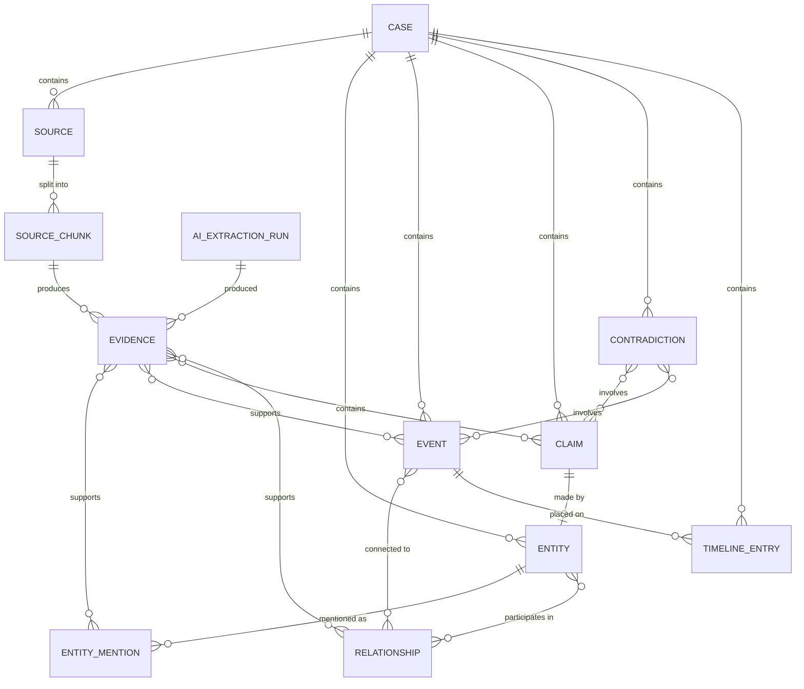

# ChronicleAI — Master Specification

> **Evidence-Centric AI Timeline Reconstruction & Investigation System**
>
> Version 0.1.0 — Draft
> Date: 2026-08-17
> Author: Architecture Team

---

## Table of Contents

1. [Project Vision](#1-project-vision)
2. [Problem Statement](#2-problem-statement)
3. [Goals](#3-goals)
4. [Non-Goals](#4-non-goals)
5. [Functional Requirements](#5-functional-requirements)
6. [Non-Functional Requirements](#6-non-functional-requirements)
7. [User Personas](#7-user-personas)
8. [User Stories](#8-user-stories)
9. [Core Use Cases](#9-core-use-cases)
10. [System Architecture](#10-system-architecture)
11. [Domain Model](#11-domain-model)
12. [Database Model](#12-database-model)
13. [Evidence Model](#13-evidence-model)
14. [Event Model](#14-event-model)
15. [Entity Model](#15-entity-model)
16. [Claim Model](#16-claim-model)
17. [Relationship Model](#17-relationship-model)
18. [Contradiction Model](#18-contradiction-model)
19. [Uncertainty Model](#19-uncertainty-model)
20. [Timeline Model](#20-timeline-model)
21. [Document Ingestion Pipeline](#21-document-ingestion-pipeline)
22. [AI Extraction Pipeline](#22-ai-extraction-pipeline)
23. [Retrieval Architecture](#23-retrieval-architecture)
24. [Investigation Architecture](#24-investigation-architecture)
25. [API Boundaries](#25-api-boundaries)
26. [Frontend Architecture](#26-frontend-architecture)
27. [Security Considerations](#27-security-considerations)
28. [Testing Strategy](#28-testing-strategy)
29. [Evaluation Methodology](#29-evaluation-methodology)
30. [Research Questions](#30-research-questions)
31. [Benchmark Dataset Strategy](#31-benchmark-dataset-strategy)
32. [Performance Considerations](#32-performance-considerations)
33. [Failure Modes](#33-failure-modes)
34. [Known Limitations](#34-known-limitations)
35. [Development Phases](#35-development-phases)
36. [Seven-Day Development Strategy](#36-seven-day-development-strategy)
37. [Definition of Done](#37-definition-of-done)
38. [Future Extensions](#38-future-extensions)
39. [Repository Structure](#39-repository-structure)
40. [Database Schema](#40-database-schema)
41. [Core Pydantic Models](#41-core-pydantic-models)
42. [API Endpoint Structure](#42-api-endpoint-structure)
43. [Frontend Page & Component Structure](#43-frontend-page--component-structure)
44. [Service & Module Boundaries](#44-service--module-boundaries)
45. [AI Component Boundaries](#45-ai-component-boundaries)
46. [Testing Hierarchy](#46-testing-hierarchy)
47. [Evaluation Metrics](#47-evaluation-metrics)

---

## 1. Project Vision

ChronicleAI is an evidence-centric AI system that reconstructs chronological timelines from heterogeneous, potentially conflicting information sources. It enables investigators, analysts, journalists, and researchers to build a rigorous, provenance-traced understanding of what happened, when, according to whom, and with what degree of certainty.

### Central Architectural Principle

> **EVIDENCE ≠ INFERENCE**

The system maintains an inviolable boundary between observed evidence (what the sources actually say) and AI-generated inferences (what the system interprets from those sources). Every claim, event, entity, and conclusion must be traceable to its supporting source evidence. The system must never silently convert an uncertain AI interpretation into an established fact.

### Core Value Propositions

| Value | Description |
|---|---|
| **Evidence-first** | Every conclusion links to source evidence |
| **Provenance** | Full traceability from conclusion → extraction → chunk → source |
| **Transparency** | Users can inspect the evidence behind any system output |
| **Uncertainty-aware** | Confidence levels and ambiguity are explicit, never hidden |
| **Contradiction-surfacing** | Conflicting evidence is flagged, never silently resolved |
| **Heterogeneous ingestion** | Accepts PDFs, DOCX, TXT, CSV, JSON, images, logs |
| **Chronological reconstruction** | Assembles a best-effort timeline from disparate sources |

---

## 2. Problem Statement

Investigators, analysts, and researchers routinely face scenarios where they must reconstruct a sequence of events from multiple, heterogeneous, and potentially contradictory sources. Current approaches are:

- **Manual** — Analysts read every document, manually extract events, and build timelines in spreadsheets or whiteboards. This is slow, error-prone, and does not scale.
- **Keyword search** — Search tools find mentions but cannot reconstruct temporal sequences or detect contradictions across documents.
- **Generic AI chat** — LLMs can summarize documents but do not preserve provenance, do not represent uncertainty, and routinely hallucinate or silently resolve contradictions.

No existing tool combines heterogeneous document ingestion, AI-assisted extraction, provenance tracking, contradiction detection, and evidence-backed investigation in a single, coherent system.

---

## 3. Goals

### Primary Goals

1. **G1** — Accept and normalize evidence from heterogeneous file formats (PDF, DOCX, TXT, CSV, JSON, images, logs).
2. **G2** — Extract entities, events, claims, and timestamps using AI with structured output schemas.
3. **G3** — Preserve full provenance from every extracted item back to its exact source location.
4. **G4** — Construct a chronological timeline from extracted events, handling imprecise and conflicting timestamps.
5. **G5** — Detect and surface contradictions and ambiguities across sources.
6. **G6** — Represent uncertainty explicitly at every level (extraction confidence, temporal precision, claim verification status).
7. **G7** — Enable users to inspect the evidence behind every event, entity, claim, and conclusion.
8. **G8** — Support evidence-backed investigation queries where every AI response cites its sources.
9. **G9** — Generate evidence-backed reports with full citations.
10. **G10** — Maintain a modular architecture that permits replacement of database, LLM provider, or individual processing components.

### Secondary Goals

11. **G11** — Provide a visual relationship graph of entities and events.
12. **G12** — Support entity resolution (merging duplicate entities across sources).
13. **G13** — Enable evaluation of AI extraction quality through benchmark datasets.
14. **G14** — Document architectural decisions and research methodology.

---

## 4. Non-Goals

| ID | Non-Goal | Rationale |
|---|---|---|
| **NG1** | Real-time streaming ingestion | Batch processing is sufficient for the target use cases |
| **NG2** | Multi-user collaboration | Single-user system initially; collaboration adds significant complexity |
| **NG3** | Authentication / authorization | Local-first application; security is out of scope for MVP |
| **NG4** | Mobile-native clients | Web-only; responsive but not a native mobile app |
| **NG5** | Automated fact-checking against external databases | The system reasons over uploaded evidence, not external truth databases |
| **NG6** | Legal admissibility guarantees | The system assists analysis; it is not a legal evidence management system |
| **NG7** | Production-scale deployment infrastructure | No Kubernetes, Kafka, Redis, Celery, or microservices |
| **NG8** | Multi-language document support | English-only initially |
| **NG9** | Video or audio ingestion | Limited to text, images, and structured data |
| **NG10** | Automated decision-making | The system surfaces evidence and inferences; humans make decisions |

---

## 5. Functional Requirements

### FR1 — Case Management

| ID | Requirement |
|---|---|
| FR1.1 | Users can create, rename, and delete cases |
| FR1.2 | Each case is an isolated container for sources, evidence, and analysis |
| FR1.3 | Cases track their creation time and last-modified time |
| FR1.4 | Cases display summary statistics (source count, event count, entity count, contradiction count) |

### FR2 — Source Ingestion

| ID | Requirement |
|---|---|
| FR2.1 | Users can upload files of types: PDF, DOCX, TXT, CSV, JSON, PNG, JPG, LOG |
| FR2.2 | Each uploaded file is stored with its original filename, MIME type, file size, and SHA-256 hash |
| FR2.3 | Files are parsed and split into chunks (pages, paragraphs, rows, or image regions) |
| FR2.4 | Each chunk stores its extracted text content and position metadata (page number, byte offset, row index) |
| FR2.5 | Processing is asynchronous; users see upload status (pending → processing → completed / failed) |
| FR2.6 | Duplicate files (same SHA-256 hash within a case) are detected and rejected |
| FR2.7 | Users can view the original source document alongside extracted chunks |

### FR3 — Entity Extraction

| ID | Requirement |
|---|---|
| FR3.1 | The system extracts entities (persons, organizations, locations, dates, objects, systems) from source chunks |
| FR3.2 | Each entity mention links to its evidence (source chunk + text span) |
| FR3.3 | The system assigns a canonical name to each entity |
| FR3.4 | The system detects potential duplicates (entity resolution candidates) |
| FR3.5 | Users can manually merge or split entities |
| FR3.6 | Each extraction carries a confidence score (0.0–1.0) |

### FR4 — Event Extraction

| ID | Requirement |
|---|---|
| FR4.1 | The system extracts events (things that happened) from source chunks |
| FR4.2 | Each event has a description, type, and one or more associated timestamps |
| FR4.3 | Timestamps are normalized to ISO 8601 with explicit precision metadata |
| FR4.4 | Each event links to its supporting evidence |
| FR4.5 | Events carry extraction confidence and temporal precision |

### FR5 — Claim Extraction

| ID | Requirement |
|---|---|
| FR5.1 | The system extracts claims (assertions made by sources) |
| FR5.2 | Each claim identifies the claimant (who said it) and the evidence (where they said it) |
| FR5.3 | Claims are distinct from events: an event is "something happened"; a claim is "source X asserts Y" |
| FR5.4 | Claims carry verification status: `unverified`, `supported`, `contradicted`, `uncertain` |

### FR6 — Timeline Construction

| ID | Requirement |
|---|---|
| FR6.1 | The system constructs a chronological timeline from extracted events |
| FR6.2 | The timeline handles imprecise timestamps (e.g., "early 2024", "before the meeting") |
| FR6.3 | The timeline displays confidence and supporting evidence for each entry |
| FR6.4 | Users can filter the timeline by entity, source, event type, date range, or confidence threshold |
| FR6.5 | Users can manually add, edit, or remove timeline entries |

### FR7 — Relationship Graph

| ID | Requirement |
|---|---|
| FR7.1 | The system identifies relationships between entities (e.g., "works for", "located at", "communicated with") |
| FR7.2 | The system identifies relationships between entities and events (e.g., "participated in", "caused") |
| FR7.3 | Relationships carry type, confidence, and supporting evidence |
| FR7.4 | Users can view an interactive graph of entities and their relationships |

### FR8 — Contradiction Detection

| ID | Requirement |
|---|---|
| FR8.1 | The system detects contradictions between claims, events, and evidence |
| FR8.2 | Each contradiction identifies the conflicting items and the nature of the conflict |
| FR8.3 | Contradictions surface the underlying evidence for each side |
| FR8.4 | Users can resolve contradictions by marking one side as preferred, noting both as valid, or flagging for further investigation |
| FR8.5 | Resolved contradictions retain their history |

### FR9 — Investigation

| ID | Requirement |
|---|---|
| FR9.1 | Users can ask natural-language questions about the case |
| FR9.2 | The system retrieves relevant evidence and generates an answer |
| FR9.3 | Every statement in the answer cites specific evidence |
| FR9.4 | The system explicitly states when evidence is insufficient or contradictory |
| FR9.5 | Investigation sessions are persisted and can be reviewed |

### FR10 — Report Generation

| ID | Requirement |
|---|---|
| FR10.1 | Users can generate structured reports from case data |
| FR10.2 | Reports include timeline, entities, events, contradictions, and evidence citations |
| FR10.3 | Reports distinguish between established facts and AI inferences |
| FR10.4 | Reports are exportable as Markdown or PDF |

---

## 6. Non-Functional Requirements

| ID | Category | Requirement |
|---|---|---|
| NFR1 | **Performance** | Source ingestion of a 50-page PDF should complete within 60 seconds (excluding AI extraction) |
| NFR2 | **Performance** | AI extraction of a single source chunk should complete within 15 seconds |
| NFR3 | **Performance** | Timeline rendering of 500 events should be smooth (60fps scrolling) |
| NFR4 | **Scalability** | A single case should support up to 100 sources and 5,000 events without degradation |
| NFR5 | **Reliability** | Failed AI extractions must not corrupt the database; partial results are saved |
| NFR6 | **Modularity** | Database, LLM provider, and embedding provider must be replaceable via interfaces |
| NFR7 | **Testability** | All service-layer logic must be testable without network calls or a running LLM |
| NFR8 | **Auditability** | All AI extraction runs are logged with model version, prompt template, and token usage |
| NFR9 | **Data integrity** | Source files and extracted text are immutable after ingestion; updates create new versions |
| NFR10 | **Usability** | Core workflows (upload → extract → view timeline) require no more than 5 clicks |

---

## 7. User Personas

### Persona 1: Investigator (Primary)

- **Name**: Alex, Fraud Investigator
- **Context**: Investigating a financial fraud case with bank statements (CSV), emails (PDF), contracts (DOCX), and transaction logs.
- **Goals**: Reconstruct the sequence of transactions, identify who communicated with whom and when, detect inconsistencies between claimed and actual transaction dates.
- **Pain points**: Manually cross-referencing hundreds of documents; losing track of which document said what; missing contradictions.

### Persona 2: Journalist

- **Name**: Sam, Investigative Journalist
- **Context**: Researching a story involving leaked documents, public records, and interview transcripts.
- **Goals**: Build an evidence-backed narrative, ensure every claim in their article is traceable to a source, identify gaps in the story.
- **Pain points**: Keeping track of provenance across dozens of sources; distinguishing between what is established and what is inferred.

### Persona 3: Researcher

- **Name**: Jordan, Academic Researcher
- **Context**: Analyzing historical events from conflicting archival sources.
- **Goals**: Construct a timeline acknowledging conflicting accounts, represent uncertainty in dating, preserve exact quotations with provenance.
- **Pain points**: Current tools force a single narrative; no good way to represent "Source A says X, but Source B says Y."

### Persona 4: Incident Analyst

- **Name**: Morgan, IT Security Analyst
- **Context**: Reconstructing a security incident from system logs, emails, and incident reports.
- **Goals**: Build a precise timeline of system events correlated with human communications, identify the attack chain, determine root cause.
- **Pain points**: Log timestamps in different formats and timezones; correlating automated logs with human-written reports.

---

## 8. User Stories

### Case Management
- **US-01**: As a user, I want to create a new case so I can organize my investigation.
- **US-02**: As a user, I want to see a list of my cases with summary statistics so I can choose which one to work on.
- **US-03**: As a user, I want to delete a case and all its associated data when I'm done with it.

### Source Ingestion
- **US-04**: As a user, I want to upload one or more files to a case so the system can analyze them.
- **US-05**: As a user, I want to see the processing status of each uploaded file.
- **US-06**: As a user, I want to preview the original source document alongside its extracted text.
- **US-07**: As a user, I want to be warned if I upload a duplicate file.

### Extraction
- **US-08**: As a user, I want the system to automatically extract entities from my uploaded documents.
- **US-09**: As a user, I want the system to automatically extract events with timestamps from my documents.
- **US-10**: As a user, I want the system to extract claims and identify who made each claim.
- **US-11**: As a user, I want to see the confidence level of every AI extraction.
- **US-12**: As a user, I want to merge duplicate entities that the system detected separately.

### Timeline
- **US-13**: As a user, I want to view all extracted events on a chronological timeline.
- **US-14**: As a user, I want to filter the timeline by entity, source, date range, or event type.
- **US-15**: As a user, I want to click on a timeline event and see the evidence behind it.
- **US-16**: As a user, I want to see uncertainty indicators on events with imprecise timestamps.

### Contradictions
- **US-17**: As a user, I want the system to alert me when two sources contradict each other.
- **US-18**: As a user, I want to see the evidence on both sides of a contradiction.
- **US-19**: As a user, I want to resolve a contradiction by choosing a preferred interpretation or flagging it.

### Investigation
- **US-20**: As a user, I want to ask questions about my case and receive evidence-backed answers.
- **US-21**: As a user, I want every statement in an AI answer to cite its source evidence.
- **US-22**: As a user, I want the AI to tell me when evidence is insufficient to answer my question.

### Reports
- **US-23**: As a user, I want to generate a report summarizing the timeline, entities, and key findings.
- **US-24**: As a user, I want the report to clearly distinguish established facts from inferences.
- **US-25**: As a user, I want to export the report as Markdown or PDF.

---

## 9. Core Use Cases

### UC1 — Upload and Process Source

```
Actor:      User
Precondition: Case exists
Flow:
  1. User selects one or more files to upload
  2. System validates file types and checks for duplicates
  3. System stores files with metadata (name, type, size, hash)
  4. System parses each file into chunks (async)
  5. System stores chunks with text content and position metadata
  6. System updates source status to "processed"
  7. User sees the processed source with its chunks
```

### UC2 — Extract Entities and Events

```
Actor:      User (trigger) / System (execution)
Precondition: Source is processed
Flow:
  1. User triggers extraction for a source (or it runs automatically)
  2. System sends each chunk to the AI extraction pipeline
  3. AI returns structured entities, events, claims with confidence scores
  4. System validates AI output against Pydantic schemas
  5. System deduplicates entities (canonical name matching)
  6. System persists extractions with provenance links to evidence
  7. System logs the extraction run (model, prompt, tokens, duration)
  8. User sees extracted entities, events, and claims
```

### UC3 — View Timeline

```
Actor:      User
Precondition: Events have been extracted
Flow:
  1. User navigates to the timeline view
  2. System retrieves all events for the case, ordered chronologically
  3. System renders events with confidence indicators and uncertainty markers
  4. User clicks an event to see its evidence and provenance chain
  5. User applies filters (entity, source, date range, confidence threshold)
```

### UC4 — Investigate

```
Actor:      User
Precondition: Extractions exist for the case
Flow:
  1. User types a natural-language question
  2. System retrieves relevant evidence chunks (keyword + semantic)
  3. System sends evidence + question to the investigation AI
  4. AI generates an answer with inline evidence citations
  5. System validates that all citations reference real evidence IDs
  6. System displays the answer with clickable citation links
  7. User clicks a citation to see the source evidence
```

### UC5 — Detect and Review Contradictions

```
Actor:      System (detection) / User (review)
Precondition: Claims and events exist
Flow:
  1. System compares claims and events for contradictions
     (temporal conflicts, factual conflicts, attribution conflicts)
  2. System creates contradiction records with linked items
  3. User views the contradictions list
  4. User inspects a contradiction, seeing evidence on both sides
  5. User resolves: prefer one side, note both as valid, or flag for investigation
```

---

## 10. System Architecture

### Architecture Style

**Modular Monolith** — A single deployable unit with well-defined internal module boundaries. This avoids the operational complexity of microservices while maintaining the separation of concerns needed for testability and future decomposition.

### High-Level Component Diagram

```
┌─────────────────────────────────────────────────────────────────────┐
│                        FRONTEND (React/Vite)                        │
│  ┌──────────┐ ┌──────────┐ ┌──────────┐ ┌──────────┐ ┌──────────┐  │
│  │  Cases   │ │ Sources  │ │ Timeline │ │  Graph   │ │ Invest.  │  │
│  └──────────┘ └──────────┘ └──────────┘ └──────────┘ └──────────┘  │
└─────────────────────────┬───────────────────────────────────────────┘
                          │ HTTP/REST (JSON)
┌─────────────────────────▼───────────────────────────────────────────┐
│                      BACKEND (FastAPI/Python)                       │
│                                                                     │
│  ┌─── API Layer ───────────────────────────────────────────────┐    │
│  │  Cases │ Sources │ Evidence │ Entities │ Events │ Timeline  │    │
│  │  Claims │ Contradictions │ Relationships │ Investigate │ ...│    │
│  └─────────────────────────┬───────────────────────────────────┘    │
│                            │                                        │
│  ┌─── Service Layer ───────▼───────────────────────────────────┐    │
│  │                                                             │    │
│  │  ┌─────────────┐  ┌─────────────┐  ┌──────────────────┐    │    │
│  │  │  Ingestion   │  │  Extraction  │  │  Timeline        │    │    │
│  │  │  Service     │  │  Service     │  │  Service         │    │    │
│  │  └─────────────┘  └──────┬──────┘  └──────────────────┘    │    │
│  │                          │                                  │    │
│  │  ┌─────────────┐  ┌─────▼───────┐  ┌──────────────────┐    │    │
│  │  │ Contradic.  │  │  AI         │  │  Investigation    │    │    │
│  │  │ Service     │  │  Service    │  │  Service          │    │    │
│  │  └─────────────┘  └─────────────┘  └──────────────────┘    │    │
│  │                                                             │    │
│  │  ┌─────────────┐  ┌─────────────┐                          │    │
│  │  │  Report     │  │  Retrieval  │                          │    │
│  │  │  Service    │  │  Service    │                          │    │
│  │  └─────────────┘  └─────────────┘                          │    │
│  └─────────────────────────────────────────────────────────────┘    │
│                            │                                        │
│  ┌─── Data Layer ──────────▼───────────────────────────────────┐    │
│  │  SQLAlchemy ORM Models + Repository Pattern                 │    │
│  └─────────────────────────┬───────────────────────────────────┘    │
│                            │                                        │
└────────────────────────────┼────────────────────────────────────────┘
                             │
                    ┌────────▼────────┐      ┌─────────────┐
                    │   SQLite DB     │      │  File Store  │
                    │  (data/app.db)  │      │ (data/files/)│
                    └─────────────────┘      └─────────────┘

                    ┌─────────────────┐
                    │  Gemini API     │ (external)
                    └─────────────────┘
```

### Key Architectural Decisions

| Decision | Choice | Rationale |
|---|---|---|
| Architecture style | Modular monolith | Simplicity; single deploy; module boundaries enforce separation |
| Database | SQLite (initially) | Zero-config; sufficient for single-user; portable; replaceable via SQLAlchemy |
| ORM | SQLAlchemy 2.0 | Mature; async support; database-agnostic; good migration tooling (Alembic) |
| API framework | FastAPI | Async support; automatic OpenAPI docs; Pydantic integration; high performance |
| AI provider | Gemini API | Structured output support; good extraction quality; replaceable via interface |
| File storage | Local filesystem | Simple; sufficient for single-user; replaceable with object storage later |
| Frontend framework | React + Vite + TypeScript | Type safety; rich ecosystem; fast dev server |
| UI components | shadcn/ui + Tailwind CSS | Accessible, customizable, copy-paste component model |
| Graph visualization | React Flow | Best-in-class React graph library for interactive diagrams |
| Charting | Recharts | Simple, composable React charts |

### Data Flow

```
Source File → Parser → Chunks → AI Extractor → Validated Extractions → Database
                                                       ↓
                                              Timeline Builder
                                              Contradiction Detector
                                              Relationship Builder
                                                       ↓
                                              User Interface
```

### Module Communication

All modules communicate through well-defined Python interfaces (abstract base classes / protocols). Modules do not import each other's internal implementation details. The API layer depends on services; services depend on repositories and the AI interface; nothing depends on the API layer.

```
API Layer  →  Service Layer  →  Repository Layer  →  Database
                    ↓
              AI Interface  →  Gemini Implementation
```

---

## 11. Domain Model

### Conceptual Entity Relationship Diagram



### Domain Glossary

| Term | Definition |
|---|---|
| **Case** | Top-level container for an investigation. All data belongs to exactly one case. |
| **Source** | An uploaded document or file. Immutable after ingestion. |
| **Source Chunk** | A segment of a source (page, paragraph, row, image region). The atomic unit of text extraction. |
| **Evidence** | A specific piece of information extracted from a source chunk. The foundational unit of provenance. |
| **Entity** | A named thing: person, organization, location, system, object. |
| **Entity Mention** | A specific textual reference to an entity within a piece of evidence. |
| **Event** | Something that happened (or is claimed to have happened) at a point or range in time. |
| **Claim** | An assertion made by a source. Distinct from an event: a claim is "Source X says Y." |
| **Relationship** | A typed connection between two entities, or between an entity and an event. |
| **Contradiction** | A detected conflict between two or more claims, events, or pieces of evidence. |
| **Timeline Entry** | An event placed on the chronological timeline with display metadata. |
| **AI Extraction Run** | An auditable record of an AI processing operation. |
| **Confidence** | A 0.0–1.0 score representing the system's certainty about an extraction or inference. |
| **Provenance Chain** | The full traceability path: Conclusion → Evidence → Source Chunk → Source |

---

## 12. Database Model

### Entity-Relationship Summary

The database uses a normalized relational schema. All tables include `id` (UUID primary key), `created_at`, and `updated_at` timestamps.

### Table Specifications

#### `cases`

| Column | Type | Constraints | Description |
|---|---|---|---|
| id | TEXT (UUID) | PK | Unique case identifier |
| name | TEXT | NOT NULL | Case name |
| description | TEXT | | Case description |
| status | TEXT | NOT NULL, DEFAULT 'active' | active, archived, deleted |
| created_at | TIMESTAMP | NOT NULL | |
| updated_at | TIMESTAMP | NOT NULL | |

#### `sources`

| Column | Type | Constraints | Description |
|---|---|---|---|
| id | TEXT (UUID) | PK | |
| case_id | TEXT | FK → cases.id, NOT NULL | |
| original_filename | TEXT | NOT NULL | Name at upload time |
| stored_filename | TEXT | NOT NULL | Name on disk (UUID-based) |
| file_type | TEXT | NOT NULL | MIME type |
| file_size | INTEGER | NOT NULL | Bytes |
| content_hash | TEXT | NOT NULL | SHA-256 of file contents |
| processing_status | TEXT | NOT NULL, DEFAULT 'pending' | pending, processing, completed, failed |
| processing_error | TEXT | | Error message if failed |
| metadata_json | TEXT | | Additional metadata (JSON) |
| created_at | TIMESTAMP | NOT NULL | |
| updated_at | TIMESTAMP | NOT NULL | |

**Index**: `UNIQUE(case_id, content_hash)` — prevents duplicate uploads within a case.

#### `source_chunks`

| Column | Type | Constraints | Description |
|---|---|---|---|
| id | TEXT (UUID) | PK | |
| source_id | TEXT | FK → sources.id, NOT NULL | |
| chunk_type | TEXT | NOT NULL | page, paragraph, row, image_region, log_entry |
| chunk_index | INTEGER | NOT NULL | Order within source |
| content_text | TEXT | | Extracted text content |
| page_number | INTEGER | | For page-based documents |
| start_offset | INTEGER | | Byte offset in source |
| end_offset | INTEGER | | Byte offset in source |
| metadata_json | TEXT | | Additional positioning metadata |
| created_at | TIMESTAMP | NOT NULL | |

**Index**: `(source_id, chunk_index)`

#### `evidence`

| Column | Type | Constraints | Description |
|---|---|---|---|
| id | TEXT (UUID) | PK | |
| case_id | TEXT | FK → cases.id, NOT NULL | |
| source_chunk_id | TEXT | FK → source_chunks.id, NOT NULL | |
| extraction_run_id | TEXT | FK → ai_extraction_runs.id | NULL for manually created evidence |
| evidence_type | TEXT | NOT NULL | text_excerpt, structured_data, image_description |
| content | TEXT | NOT NULL | The extracted content |
| raw_text_span | TEXT | | The exact original text (before normalization) |
| extraction_method | TEXT | NOT NULL | manual, ai_extraction, rule_based |
| confidence | REAL | NOT NULL, DEFAULT 1.0 | 0.0–1.0 |
| verified_by_user | BOOLEAN | NOT NULL, DEFAULT FALSE | Has a human verified this? |
| created_at | TIMESTAMP | NOT NULL | |

**Index**: `(case_id)`, `(source_chunk_id)`

#### `entities`

| Column | Type | Constraints | Description |
|---|---|---|---|
| id | TEXT (UUID) | PK | |
| case_id | TEXT | FK → cases.id, NOT NULL | |
| canonical_name | TEXT | NOT NULL | Resolved display name |
| entity_type | TEXT | NOT NULL | person, organization, location, system, object, date_reference, other |
| description | TEXT | | AI-generated description |
| metadata_json | TEXT | | Additional structured metadata |
| created_at | TIMESTAMP | NOT NULL | |
| updated_at | TIMESTAMP | NOT NULL | |

**Index**: `(case_id, entity_type)`

#### `entity_mentions`

| Column | Type | Constraints | Description |
|---|---|---|---|
| id | TEXT (UUID) | PK | |
| entity_id | TEXT | FK → entities.id, NOT NULL | |
| evidence_id | TEXT | FK → evidence.id, NOT NULL | |
| mention_text | TEXT | NOT NULL | The exact text mention |
| confidence | REAL | NOT NULL, DEFAULT 1.0 | Confidence in the entity assignment |
| created_at | TIMESTAMP | NOT NULL | |

**Index**: `(entity_id)`, `(evidence_id)`

#### `events`

| Column | Type | Constraints | Description |
|---|---|---|---|
| id | TEXT (UUID) | PK | |
| case_id | TEXT | FK → cases.id, NOT NULL | |
| description | TEXT | NOT NULL | What happened |
| event_type | TEXT | NOT NULL | action, communication, transaction, system_event, observation, other |
| timestamp_start | TIMESTAMP | | Normalized start timestamp |
| timestamp_end | TIMESTAMP | | Normalized end timestamp (for ranges) |
| timestamp_raw | TEXT | | Original timestamp text from source |
| timestamp_precision | TEXT | NOT NULL, DEFAULT 'unknown' | exact, day, week, month, year, approximate, relative, unknown |
| timezone_source | TEXT | | Original timezone if known |
| confidence | REAL | NOT NULL, DEFAULT 1.0 | |
| metadata_json | TEXT | | Additional structured metadata |
| created_at | TIMESTAMP | NOT NULL | |
| updated_at | TIMESTAMP | NOT NULL | |

**Index**: `(case_id, timestamp_start)`

#### `event_evidence`

Join table linking events to their supporting evidence.

| Column | Type | Constraints | Description |
|---|---|---|---|
| id | TEXT (UUID) | PK | |
| event_id | TEXT | FK → events.id, NOT NULL | |
| evidence_id | TEXT | FK → evidence.id, NOT NULL | |
| relationship_type | TEXT | NOT NULL | supports, contradicts, contextualizes |
| confidence | REAL | NOT NULL, DEFAULT 1.0 | |
| created_at | TIMESTAMP | NOT NULL | |

**Index**: `UNIQUE(event_id, evidence_id)`

#### `claims`

| Column | Type | Constraints | Description |
|---|---|---|---|
| id | TEXT (UUID) | PK | |
| case_id | TEXT | FK → cases.id, NOT NULL | |
| evidence_id | TEXT | FK → evidence.id, NOT NULL | Source evidence for this claim |
| claim_text | TEXT | NOT NULL | The assertion |
| claim_type | TEXT | NOT NULL | factual, temporal, causal, attribution, quantitative, other |
| claimant_entity_id | TEXT | FK → entities.id | Who made the claim (if identifiable) |
| subject_entity_id | TEXT | FK → entities.id | Who/what the claim is about |
| verification_status | TEXT | NOT NULL, DEFAULT 'unverified' | unverified, supported, contradicted, uncertain |
| confidence | REAL | NOT NULL, DEFAULT 1.0 | |
| created_at | TIMESTAMP | NOT NULL | |
| updated_at | TIMESTAMP | NOT NULL | |

**Index**: `(case_id, verification_status)`

#### `relationships`

| Column | Type | Constraints | Description |
|---|---|---|---|
| id | TEXT (UUID) | PK | |
| case_id | TEXT | FK → cases.id, NOT NULL | |
| relationship_type | TEXT | NOT NULL | works_for, located_at, communicated_with, participated_in, caused, related_to, etc. |
| source_entity_id | TEXT | FK → entities.id | One end (entity) |
| target_entity_id | TEXT | FK → entities.id | Other end (entity) |
| event_id | TEXT | FK → events.id | Related event (if applicable) |
| description | TEXT | | |
| confidence | REAL | NOT NULL, DEFAULT 1.0 | |
| metadata_json | TEXT | | |
| created_at | TIMESTAMP | NOT NULL | |

**Index**: `(case_id)`, `(source_entity_id)`, `(target_entity_id)`

#### `relationship_evidence`

| Column | Type | Constraints | Description |
|---|---|---|---|
| id | TEXT (UUID) | PK | |
| relationship_id | TEXT | FK → relationships.id, NOT NULL | |
| evidence_id | TEXT | FK → evidence.id, NOT NULL | |
| confidence | REAL | NOT NULL, DEFAULT 1.0 | |
| created_at | TIMESTAMP | NOT NULL | |

#### `contradictions`

| Column | Type | Constraints | Description |
|---|---|---|---|
| id | TEXT (UUID) | PK | |
| case_id | TEXT | FK → cases.id, NOT NULL | |
| description | TEXT | NOT NULL | Human-readable description of the conflict |
| contradiction_type | TEXT | NOT NULL | temporal, factual, attribution, quantitative, other |
| severity | TEXT | NOT NULL, DEFAULT 'medium' | low, medium, high, critical |
| resolution_status | TEXT | NOT NULL, DEFAULT 'unresolved' | unresolved, resolved, noted, flagged |
| resolution_notes | TEXT | | How / why it was resolved |
| resolved_at | TIMESTAMP | | |
| created_at | TIMESTAMP | NOT NULL | |
| updated_at | TIMESTAMP | NOT NULL | |

**Index**: `(case_id, resolution_status)`

#### `contradiction_items`

| Column | Type | Constraints | Description |
|---|---|---|---|
| id | TEXT (UUID) | PK | |
| contradiction_id | TEXT | FK → contradictions.id, NOT NULL | |
| item_type | TEXT | NOT NULL | claim, event, evidence |
| item_id | TEXT | NOT NULL | FK to the appropriate table |
| role | TEXT | NOT NULL | side_a, side_b |
| created_at | TIMESTAMP | NOT NULL | |

#### `timeline_entries`

| Column | Type | Constraints | Description |
|---|---|---|---|
| id | TEXT (UUID) | PK | |
| case_id | TEXT | FK → cases.id, NOT NULL | |
| event_id | TEXT | FK → events.id, NOT NULL, UNIQUE | |
| display_label | TEXT | | Override label for timeline display |
| importance | TEXT | NOT NULL, DEFAULT 'normal' | low, normal, high, critical |
| is_pinned | BOOLEAN | NOT NULL, DEFAULT FALSE | User-pinned to timeline |
| is_hidden | BOOLEAN | NOT NULL, DEFAULT FALSE | User-hidden from timeline |
| created_at | TIMESTAMP | NOT NULL | |
| updated_at | TIMESTAMP | NOT NULL | |

#### `ai_extraction_runs`

| Column | Type | Constraints | Description |
|---|---|---|---|
| id | TEXT (UUID) | PK | |
| case_id | TEXT | FK → cases.id, NOT NULL | |
| source_id | TEXT | FK → sources.id | |
| extraction_type | TEXT | NOT NULL | entity, event, claim, relationship, full |
| model_name | TEXT | NOT NULL | e.g., gemini-2.5-flash |
| model_version | TEXT | | |
| prompt_template_id | TEXT | | Identifier for the prompt used |
| status | TEXT | NOT NULL | pending, running, completed, failed |
| error_message | TEXT | | |
| input_tokens | INTEGER | | |
| output_tokens | INTEGER | | |
| duration_ms | INTEGER | | |
| started_at | TIMESTAMP | | |
| completed_at | TIMESTAMP | | |
| created_at | TIMESTAMP | NOT NULL | |

#### `investigation_sessions`

| Column | Type | Constraints | Description |
|---|---|---|---|
| id | TEXT (UUID) | PK | |
| case_id | TEXT | FK → cases.id, NOT NULL | |
| title | TEXT | | |
| created_at | TIMESTAMP | NOT NULL | |
| updated_at | TIMESTAMP | NOT NULL | |

#### `investigation_messages`

| Column | Type | Constraints | Description |
|---|---|---|---|
| id | TEXT (UUID) | PK | |
| session_id | TEXT | FK → investigation_sessions.id, NOT NULL | |
| role | TEXT | NOT NULL | user, assistant |
| content | TEXT | NOT NULL | |
| citations_json | TEXT | | JSON array of evidence IDs cited |
| model_name | TEXT | | |
| input_tokens | INTEGER | | |
| output_tokens | INTEGER | | |
| created_at | TIMESTAMP | NOT NULL | |

---

## 13. Evidence Model

Evidence is the foundational unit of ChronicleAI. The evidence model enforces the core principle that every inference traces back to source material.

### Evidence Hierarchy

```
Source (file)
  └── Source Chunk (segment of file)
       └── Evidence (specific extracted information)
            ├── Entity Mention (links to Entity)
            ├── Event support (links to Event)
            ├── Claim (assertion from the source)
            └── Relationship support (links to Relationship)
```

### Evidence Types

| Type | Description | Example |
|---|---|---|
| `text_excerpt` | Verbatim or near-verbatim text from a source | "The meeting occurred on March 15th" |
| `structured_data` | Data from a structured source (CSV row, JSON field) | `{"amount": 5000, "date": "2024-03-15"}` |
| `image_description` | Description of visual content from an image | "Photograph showing two individuals at a conference" |

### Extraction Methods

| Method | Description | Default Confidence |
|---|---|---|
| `manual` | User-created evidence | 1.0 |
| `ai_extraction` | Extracted by AI from source chunks | 0.0–1.0 (model-determined) |
| `rule_based` | Extracted by deterministic rules (regex, parsing) | 0.9–1.0 |

### Evidence Invariants

1. Every piece of evidence links to exactly one source chunk.
2. Evidence content is immutable after creation.
3. Evidence carries the original raw text span before any normalization.
4. AI-extracted evidence always references an extraction run.
5. Confidence of AI-extracted evidence is never silently set to 1.0.

---

## 14. Event Model

Events represent things that happened (or are claimed to have happened) at a point or range in time.

### Temporal Representation

Events use a dual-timestamp model with explicit precision metadata:

```python
timestamp_start: datetime | None      # Normalized start (UTC)
timestamp_end: datetime | None        # Normalized end (UTC), for ranges
timestamp_raw: str | None             # Original text: "early March 2024"
timestamp_precision: TimestampPrecision  # How precise is this?
timezone_source: str | None           # Original timezone if known
```

### Timestamp Precision Levels

| Level | Meaning | Example |
|---|---|---|
| `exact` | Precise to seconds or better | "2024-03-15T14:30:00Z" |
| `minute` | Precise to the minute | "2:30 PM" |
| `hour` | Precise to the hour | "around 2 PM" |
| `day` | Precise to the day | "March 15th" |
| `week` | Precise to the week | "the week of March 11th" |
| `month` | Precise to the month | "in March 2024" |
| `quarter` | Precise to the quarter | "Q1 2024" |
| `year` | Precise to the year | "in 2024" |
| `approximate` | Vaguely placed in time | "around that time" |
| `relative` | Relative to another event | "after the meeting" |
| `unknown` | No temporal information | "at some point" |

### Event Types

`action`, `communication`, `transaction`, `system_event`, `observation`, `decision`, `state_change`, `other`

### Event Invariants

1. Every event is supported by at least one piece of evidence (enforced at service layer, not DB).
2. Events with `relative` precision store the reference event ID in metadata.
3. `timestamp_raw` is always preserved, even when normalization succeeds.
4. Events never have `confidence = 1.0` unless user-verified.

---

## 15. Entity Model

Entities represent named things mentioned in sources.

### Entity Types

| Type | Description | Examples |
|---|---|---|
| `person` | Individual human | "John Smith", "the CEO" |
| `organization` | Company, agency, group | "Acme Corp", "FBI" |
| `location` | Physical or virtual place | "Building 7", "server-prod-01" |
| `system` | Technical system or tool | "SAP ERP", "Exchange Server" |
| `object` | Physical or digital artifact | "Contract #4521", "the USB drive" |
| `date_reference` | Named time reference | "the March deadline" |
| `monetary_value` | Financial amount | "$50,000 transfer" |
| `other` | Uncategorized | |

### Entity Resolution Strategy

Entity resolution (deduplication) is a multi-step process:

1. **Exact match** — Same canonical name → auto-merge.
2. **Fuzzy match** — Similar names (edit distance, alias matching) → suggest merge to user.
3. **Contextual match** — AI identifies potential duplicates from context → suggest merge to user.
4. **Manual merge** — User explicitly merges two entities; all mentions transfer to the surviving entity.

### Entity Invariants

1. An entity's existence is justified by at least one entity mention.
2. Entity mentions always reference evidence.
3. Merging entities never deletes data; the deprecated entity's mentions transfer.

---

## 16. Claim Model

Claims represent assertions made by sources. They are the bridge between evidence and the system's understanding.

### Claim vs. Event vs. Evidence

| Concept | Question it answers | Example |
|---|---|---|
| Evidence | "What does the source literally say?" | Page 3, paragraph 2 of the contract |
| Claim | "What assertion is being made?" | "Source A claims the payment was made on March 15" |
| Event | "What happened?" | "Payment of $5,000 was made (date disputed)" |

### Claim Types

| Type | Description | Example |
|---|---|---|
| `factual` | Assertion about a fact | "The door was locked" |
| `temporal` | Assertion about when something happened | "The meeting was at 3 PM" |
| `causal` | Assertion about cause and effect | "The fire was caused by an electrical fault" |
| `attribution` | Assertion about who did something | "Smith authorized the transfer" |
| `quantitative` | Assertion about amounts or quantities | "The loss was $2 million" |
| `other` | Uncategorized assertion | |

### Verification Status

| Status | Meaning |
|---|---|
| `unverified` | Extracted but not corroborated or contradicted |
| `supported` | Corroborated by independent evidence |
| `contradicted` | Contradicted by other evidence |
| `uncertain` | Evidence is ambiguous or insufficient |

### Claim Invariants

1. Every claim references exactly one piece of evidence.
2. Claims are never silently promoted from `unverified` to `supported` without corroborating evidence.
3. The `contradicted` status is only set by the contradiction detection system, not directly by extraction.

---

## 17. Relationship Model

Relationships represent typed connections between entities, and between entities and events.

### Relationship Types

#### Entity ↔ Entity

| Type | Meaning | Example |
|---|---|---|
| `works_for` | Employment/organizational | "Smith works for Acme Corp" |
| `manages` | Supervisory | "Jones manages Smith" |
| `communicates_with` | Communication link | "Smith emailed Jones" |
| `related_to` | General relation | "Smith and Jones are co-signers" |
| `located_at` | Physical/virtual location | "Server is in Building 7" |
| `owns` | Ownership | "Smith owns the account" |
| `alias_of` | Alternative name | "J. Smith is alias of John Smith" |

#### Entity ↔ Event

| Type | Meaning | Example |
|---|---|---|
| `participated_in` | Was involved in the event | "Smith attended the meeting" |
| `initiated` | Started/caused the event | "Smith authorized the transfer" |
| `affected_by` | Was affected by the event | "Smith was impacted by the breach" |
| `witnessed` | Observed the event | "Jones witnessed the incident" |

### Relationship Invariants

1. Every relationship is supported by at least one piece of evidence.
2. Relationships carry confidence scores.
3. Bidirectional relationships are stored once with a canonical direction.

---

## 18. Contradiction Model

Contradictions represent detected conflicts between pieces of information.

### Contradiction Types

| Type | Detection Method | Example |
|---|---|---|
| `temporal` | Two events with overlapping subjects but incompatible timestamps | "Source A says meeting at 2 PM; Source B says 4 PM" |
| `factual` | Two claims about the same subject with incompatible assertions | "Source A says door was locked; Source B says unlocked" |
| `attribution` | Conflicting claims about who did something | "Source A says Smith authorized; Source B says Jones" |
| `quantitative` | Conflicting numerical claims | "Source A says $5,000; Source B says $50,000" |
| `existence` | One source claims something happened; another denies it | "Source A describes a meeting; Source B says no meeting occurred" |

### Contradiction Detection Strategy

Contradiction detection uses a layered approach:

1. **Deterministic checks** — Same entity + same date + conflicting assertions → automatic contradiction.
2. **Temporal overlap** — Events about the same entities with incompatible timestamps → candidate contradiction.
3. **AI-assisted** — Semantic comparison of claims about the same subjects → candidate contradiction with confidence score.
4. **User-reported** — Users can flag contradictions manually.

### Resolution Model

| Status | Meaning |
|---|---|
| `unresolved` | Detected but not reviewed |
| `resolved` | User has selected a preferred interpretation |
| `noted` | User acknowledges the conflict but keeps both sides |
| `flagged` | Marked for further investigation |

### Contradiction Invariants

1. Contradictions always reference at least two items (the conflicting sides).
2. Resolution never deletes the contradicting evidence.
3. Resolution notes explain the rationale.

---

## 19. Uncertainty Model

Uncertainty is a first-class concept in ChronicleAI, not an afterthought.

### Dimensions of Uncertainty

| Dimension | Where it applies | Representation |
|---|---|---|
| **Extraction confidence** | Entities, events, claims, relationships | `confidence: float` (0.0–1.0) |
| **Temporal precision** | Events, timeline entries | `timestamp_precision` enum |
| **Verification status** | Claims | `verification_status` enum |
| **Provenance strength** | Evidence | `extraction_method` + `confidence` |
| **Resolution status** | Contradictions | `resolution_status` enum |
| **User verification** | Evidence | `verified_by_user: bool` |

### Confidence Score Guidelines

| Range | Meaning | Visual |
|---|---|---|
| 0.9–1.0 | High confidence, well-supported | Solid indicator |
| 0.7–0.89 | Moderate confidence, likely correct | Standard indicator |
| 0.5–0.69 | Low confidence, plausible but uncertain | Warning indicator |
| 0.0–0.49 | Very low confidence, speculative | Danger indicator |

### Uncertainty Propagation

When combining multiple uncertain inputs:
- **Timeline placement**: The lowest confidence among supporting evidence determines event confidence.
- **Relationship confidence**: Product of the individual entity confidences and the relationship extraction confidence.
- **Contradiction severity**: Higher when both sides have high confidence.

### Uncertainty Display Rules

1. Confidence scores are always visible in the UI (not hidden behind menus).
2. Low-confidence items use visual differentiation (muted colors, dashed borders, warning icons).
3. Unverified AI extractions are labeled as such.
4. The timeline distinguishes between firm dates and approximate placements.

---

## 20. Timeline Model

The timeline is the primary output of ChronicleAI — a chronological reconstruction of events from multiple sources.

### Timeline Construction Algorithm

```
1. Gather all events for the case
2. Partition events by timestamp precision:
   a. Firm events (exact/minute/hour/day) → place at normalized timestamp
   b. Approximate events (week/month/quarter/year) → place at midpoint of range
   c. Relative events → resolve relative references, place after/before anchor
   d. Unknown events → place in a separate "undated" section
3. Sort by timestamp_start, then by confidence (descending)
4. Mark temporal clusters (events within a configurable window)
5. Detect temporal overlaps for the same entity (contradiction candidates)
6. Generate timeline entries with display metadata
```

### Timeline Features

- **Zoom levels**: Year → Quarter → Month → Week → Day → Hour
- **Filtering**: By entity, source, event type, date range, confidence threshold
- **Grouping**: By source, by entity, or flat chronological
- **Evidence drill-down**: Click any event to see supporting evidence
- **Uncertainty visualization**: Imprecise events shown with fuzzy boundaries
- **Contradiction markers**: Events involved in contradictions are visually flagged

### Timeline Invariants

1. Every timeline entry references exactly one event.
2. Timeline construction is deterministic given the same event data.
3. Hidden/pinned status is user preference, not data mutation.

---

## 21. Document Ingestion Pipeline

### Pipeline Stages

```
Upload → Validate → Store → Parse → Chunk → Index
```

### Stage Details

#### Stage 1: Upload & Validate

- Accept file via multipart upload
- Validate file type against allowlist
- Compute SHA-256 hash
- Check for duplicates within the case
- Enforce file size limits (configurable, default 50MB per file)

#### Stage 2: Store

- Save file to `data/files/{case_id}/{uuid}.{ext}`
- Create `sources` record with metadata

#### Stage 3: Parse

Each file type has a dedicated parser implementing a common interface:

| File Type | Parser | Output |
|---|---|---|
| PDF | PyMuPDF (`fitz`) | Pages with text, images, metadata |
| DOCX | `python-docx` | Paragraphs, tables, metadata |
| TXT | Built-in | Lines/paragraphs |
| CSV | `pandas` | Rows with column headers |
| JSON | Built-in `json` | Flattened key-value pairs or records |
| Images (PNG/JPG) | Pillow + optional OCR | Text extraction or description |
| LOG | Custom regex parser | Log entries |

#### Stage 4: Chunk

- Split parser output into `source_chunks`
- Assign sequential `chunk_index`
- Store text content and position metadata

#### Parser Interface

```python
class BaseParser(ABC):
    @abstractmethod
    def can_handle(self, file_type: str) -> bool: ...

    @abstractmethod
    def parse(self, file_path: Path, source_id: str) -> list[SourceChunkCreate]: ...
```

### Ingestion Invariants

1. The original file is never modified.
2. Parsing is deterministic: the same file always produces the same chunks.
3. If parsing fails, the source status is set to `failed` with an error message; no chunks are created.
4. Parsing and AI extraction are separate stages; parsing never calls the LLM.

---

## 22. AI Extraction Pipeline

### Pipeline Architecture

```
Source Chunks → Batch → Prompt Construction → LLM Call → Response Parsing
     → Schema Validation → Deduplication → Persistence → Run Logging
```

### Extraction Types

| Extraction | Input | Output | Prompt Strategy |
|---|---|---|---|
| Entity extraction | Source chunk text | List of entities with mentions | Few-shot with entity type taxonomy |
| Event extraction | Source chunk text | List of events with timestamps | Few-shot with timestamp normalization examples |
| Claim extraction | Source chunk text | List of claims with claimants | Few-shot with claim type taxonomy |
| Relationship extraction | Source chunk text + extracted entities | List of relationships | Provide extracted entities as context |

### Structured Output Strategy

All LLM calls use structured output schemas (Gemini's JSON mode or function calling). Every extraction has a corresponding Pydantic schema that the LLM output must conform to.

```python
class ExtractedEntity(BaseModel):
    name: str
    entity_type: EntityType
    description: str | None
    mentions: list[TextSpan]
    confidence: float = Field(ge=0.0, le=1.0)

class ExtractedEvent(BaseModel):
    description: str
    event_type: EventType
    timestamp_raw: str | None
    timestamp_normalized: str | None  # ISO 8601
    timestamp_precision: TimestampPrecision
    participants: list[str]  # Entity names
    confidence: float = Field(ge=0.0, le=1.0)

class ExtractedClaim(BaseModel):
    claim_text: str
    claim_type: ClaimType
    claimant: str | None
    subject: str | None
    confidence: float = Field(ge=0.0, le=1.0)
```

### AI Output Validation

Before persisting, every AI output goes through:

1. **Schema validation** — Must conform to the Pydantic model.
2. **Confidence bounds** — Confidence must be in [0.0, 1.0]; values outside are clamped.
3. **Timestamp validation** — Normalized timestamps must be parseable; invalid timestamps fall back to `unknown` precision.
4. **Reference validation** — Entity names in events/relationships must match known or newly-extracted entities.
5. **Deduplication** — Check for existing entities with the same canonical name; merge or flag.

### AI Interface Abstraction

```python
class LLMProvider(ABC):
    @abstractmethod
    async def extract_structured(
        self,
        prompt: str,
        response_schema: type[BaseModel],
        temperature: float = 0.1,
    ) -> BaseModel: ...

    @abstractmethod
    async def generate_text(
        self,
        prompt: str,
        system_instruction: str | None = None,
        temperature: float = 0.3,
    ) -> str: ...
```

This interface allows swapping Gemini for OpenAI, Anthropic, or local models without changing service code.

### Extraction Run Logging

Every AI call is logged in `ai_extraction_runs` with:
- Model name and version
- Prompt template identifier
- Input/output token counts
- Duration
- Status (success/failure)
- Error message if failed

### Extraction Invariants

1. AI never writes directly to the database; the service layer validates and persists.
2. All extraction outputs are tagged with `extraction_method = 'ai_extraction'`.
3. AI-extracted items never have `confidence = 1.0` unless overridden by user verification.
4. Failed extractions do not corrupt existing data; they are logged and can be retried.
5. Prompts are versioned; changing a prompt creates a new template identifier.

---

## 23. Retrieval Architecture

Retrieval is used by the investigation system to find relevant evidence for user queries.

### Retrieval Strategy

For the MVP, use a hybrid retrieval approach:

#### Layer 1: Keyword Search (SQLite FTS5)

- Create a full-text search index on `source_chunks.content_text` and `evidence.content`.
- Use BM25 ranking for keyword relevance.
- Fast, deterministic, no external dependencies.

#### Layer 2: Metadata Filtering

- Filter by case_id, source_id, entity references, event types, date ranges.
- Applied as SQL WHERE clauses before or after FTS.

#### Layer 3: AI Re-ranking (Optional, Phase 6+)

- Take top-K results from keyword search.
- Use the LLM to re-rank by relevance to the user's question.
- Only applied for investigation queries, not for general browsing.

### Future: Semantic Search

In a future phase, add embedding-based retrieval:
- Embed source chunks using an embedding model (e.g., Gemini embedding).
- Store embeddings in a vector store (SQLite with `sqlite-vec`, or external).
- Combine with keyword search in a hybrid retrieval pipeline.

This is deferred because:
- Keyword search + metadata filtering is sufficient for cases with < 100 sources.
- Embedding adds infrastructure complexity.
- The modular architecture makes it easy to add later.

---

## 24. Investigation Architecture

The investigation system enables evidence-backed Q&A over case data.

### Investigation Flow

```
User Question
    ↓
Query Analysis (determine what to retrieve)
    ↓
Evidence Retrieval (keyword search + metadata filtering)
    ↓
Context Assembly (format retrieved evidence with citations)
    ↓
Answer Generation (LLM with evidence context)
    ↓
Citation Validation (verify all citations reference real evidence)
    ↓
Response Display (answer with clickable citation links)
```

### System Prompt Design

The investigation AI operates under strict constraints:

```
You are an evidence analyst. Answer the user's question based ONLY 
on the provided evidence. For every factual statement in your answer, 
cite the evidence ID in [brackets].

Rules:
1. Only use information from the provided evidence.
2. If the evidence is insufficient, say so explicitly.
3. If the evidence is contradictory, present both sides with citations.
4. Never state something as fact if the evidence only suggests it.
5. Distinguish between what the evidence says and what you infer.
6. Use phrases like "According to [E-123]..." or "Evidence suggests..."
```

### Citation Format

```json
{
  "answer": "According to [E-001], the meeting occurred on March 15th. However, [E-047] places the meeting on March 16th, creating a temporal contradiction.",
  "citations": ["E-001", "E-047"],
  "confidence": 0.7,
  "evidence_sufficient": true,
  "contradictions_noted": true
}
```

### Investigation Invariants

1. Every AI answer must cite at least one piece of evidence (or explicitly state evidence is insufficient).
2. Citations must reference real evidence IDs in the database.
3. Invalid citations are stripped before display, with a warning.
4. Investigation never modifies case data; it is read-only.
5. Investigation sessions are persisted for auditability.

---

## 25. API Boundaries

### API Design Principles

- RESTful resource-based URLs
- JSON request/response bodies
- Consistent error response format
- Pagination for list endpoints
- All endpoints scoped under `/api/v1/`

### Endpoint Map

#### Cases

| Method | Path | Description |
|---|---|---|
| GET | `/api/v1/cases` | List all cases |
| POST | `/api/v1/cases` | Create a new case |
| GET | `/api/v1/cases/{case_id}` | Get case with summary stats |
| PUT | `/api/v1/cases/{case_id}` | Update case metadata |
| DELETE | `/api/v1/cases/{case_id}` | Delete case and all data |

#### Sources

| Method | Path | Description |
|---|---|---|
| GET | `/api/v1/cases/{case_id}/sources` | List sources in case |
| POST | `/api/v1/cases/{case_id}/sources/upload` | Upload a source file |
| GET | `/api/v1/cases/{case_id}/sources/{source_id}` | Get source with chunks |
| DELETE | `/api/v1/cases/{case_id}/sources/{source_id}` | Delete source |
| POST | `/api/v1/cases/{case_id}/sources/{source_id}/extract` | Trigger AI extraction |
| GET | `/api/v1/cases/{case_id}/sources/{source_id}/chunks` | List chunks |

#### Evidence

| Method | Path | Description |
|---|---|---|
| GET | `/api/v1/cases/{case_id}/evidence` | List evidence (filterable) |
| GET | `/api/v1/cases/{case_id}/evidence/{evidence_id}` | Get evidence detail with provenance |
| PUT | `/api/v1/cases/{case_id}/evidence/{evidence_id}/verify` | User-verify evidence |

#### Entities

| Method | Path | Description |
|---|---|---|
| GET | `/api/v1/cases/{case_id}/entities` | List entities (filterable by type) |
| GET | `/api/v1/cases/{case_id}/entities/{entity_id}` | Get entity with mentions |
| PUT | `/api/v1/cases/{case_id}/entities/{entity_id}` | Update entity metadata |
| POST | `/api/v1/cases/{case_id}/entities/merge` | Merge two entities |

#### Events

| Method | Path | Description |
|---|---|---|
| GET | `/api/v1/cases/{case_id}/events` | List events (filterable, sortable) |
| GET | `/api/v1/cases/{case_id}/events/{event_id}` | Get event with evidence |
| PUT | `/api/v1/cases/{case_id}/events/{event_id}` | Update event metadata |

#### Claims

| Method | Path | Description |
|---|---|---|
| GET | `/api/v1/cases/{case_id}/claims` | List claims (filterable by status) |
| GET | `/api/v1/cases/{case_id}/claims/{claim_id}` | Get claim detail |
| PUT | `/api/v1/cases/{case_id}/claims/{claim_id}` | Update verification status |

#### Timeline

| Method | Path | Description |
|---|---|---|
| GET | `/api/v1/cases/{case_id}/timeline` | Get timeline entries (filterable) |
| PUT | `/api/v1/cases/{case_id}/timeline/{entry_id}` | Update timeline display settings |
| GET | `/api/v1/cases/{case_id}/timeline/export` | Export timeline (JSON/CSV) |

#### Contradictions

| Method | Path | Description |
|---|---|---|
| GET | `/api/v1/cases/{case_id}/contradictions` | List contradictions |
| GET | `/api/v1/cases/{case_id}/contradictions/{id}` | Get contradiction detail |
| PUT | `/api/v1/cases/{case_id}/contradictions/{id}/resolve` | Resolve contradiction |

#### Relationships

| Method | Path | Description |
|---|---|---|
| GET | `/api/v1/cases/{case_id}/relationships` | List relationships |
| GET | `/api/v1/cases/{case_id}/relationships/graph` | Get graph data (nodes + edges) |

#### Investigation

| Method | Path | Description |
|---|---|---|
| POST | `/api/v1/cases/{case_id}/investigate` | Ask a question |
| GET | `/api/v1/cases/{case_id}/investigate/sessions` | List sessions |
| GET | `/api/v1/cases/{case_id}/investigate/sessions/{id}` | Get session history |

#### Reports

| Method | Path | Description |
|---|---|---|
| POST | `/api/v1/cases/{case_id}/reports/generate` | Generate a report |
| GET | `/api/v1/cases/{case_id}/reports` | List reports |
| GET | `/api/v1/cases/{case_id}/reports/{id}` | Get report content |
| GET | `/api/v1/cases/{case_id}/reports/{id}/download` | Download report file |

### Standard Response Envelope

```json
{
  "data": { ... },
  "meta": {
    "page": 1,
    "per_page": 50,
    "total": 142
  }
}
```

### Standard Error Response

```json
{
  "error": {
    "code": "VALIDATION_ERROR",
    "message": "File type 'exe' is not supported",
    "details": { ... }
  }
}
```

---

## 26. Frontend Architecture

### Technology Stack

| Layer | Technology |
|---|---|
| Framework | React 19 + TypeScript |
| Build | Vite |
| Styling | Tailwind CSS v4 |
| Components | shadcn/ui |
| Routing | React Router v7 |
| State | Zustand (lightweight) or React Query for server state |
| Data fetching | TanStack Query (React Query) |
| Graph visualization | React Flow |
| Charts | Recharts |
| Icons | Lucide React |

### Page Structure

| Route | Page | Description |
|---|---|---|
| `/` | Dashboard | Case list with summary cards |
| `/cases/:id` | Case Overview | Case details, stats, recent activity |
| `/cases/:id/sources` | Sources | Upload, list, preview sources |
| `/cases/:id/timeline` | Timeline | Interactive chronological timeline |
| `/cases/:id/entities` | Entities | Entity list with filtering |
| `/cases/:id/entities/:eid` | Entity Detail | Entity with all mentions, relationships |
| `/cases/:id/events` | Events | Event list with filtering |
| `/cases/:id/events/:eid` | Event Detail | Event with evidence, timeline position |
| `/cases/:id/claims` | Claims | Claim list with verification status |
| `/cases/:id/contradictions` | Contradictions | Contradiction list with resolution UI |
| `/cases/:id/graph` | Evidence Graph | Interactive relationship graph |
| `/cases/:id/investigate` | Investigation | Chat-style Q&A interface |
| `/cases/:id/reports` | Reports | Report list, generation, viewing |

### Component Hierarchy

```
App
├── Layout
│   ├── Sidebar (case navigation)
│   └── TopBar (breadcrumbs, case selector)
├── Pages
│   ├── DashboardPage
│   │   └── CaseCard, CaseCreateDialog
│   ├── CaseOverviewPage
│   │   └── StatCard, RecentActivity
│   ├── SourcesPage
│   │   └── FileUploader, SourceList, SourcePreview, ChunkViewer
│   ├── TimelinePage
│   │   └── TimelineView, TimelineControls, TimelineEvent, TimelineFilter
│   ├── EntitiesPage / EntityDetailPage
│   │   └── EntityCard, EntityList, MergeDialog, MentionList
│   ├── EventsPage / EventDetailPage
│   │   └── EventCard, EvidenceList, ProvenanceChain
│   ├── ClaimsPage
│   │   └── ClaimCard, VerificationBadge
│   ├── ContradictionsPage
│   │   └── ContradictionCard, ResolutionDialog, EvidenceComparison
│   ├── GraphPage
│   │   └── ReactFlowGraph, GraphControls, NodeDetail
│   ├── InvestigationPage
│   │   └── ChatInterface, MessageBubble, CitationLink, SessionList
│   └── ReportsPage
│       └── ReportBuilder, ReportViewer, ExportButton
└── Shared Components
    ├── ConfidenceBadge
    ├── UncertaintyIndicator
    ├── EvidencePopover
    ├── ProvenanceTrail
    ├── EmptyState
    ├── LoadingState
    ├── ErrorBoundary
    └── Pagination
```

### Key Frontend Patterns

1. **Server state via TanStack Query** — All API data is fetched, cached, and invalidated through React Query. No manual `useEffect` + `useState` for API calls.
2. **Optimistic updates** — For user actions like resolving contradictions or verifying evidence.
3. **Evidence popover** — Clicking any evidence reference shows a popover with the source text and provenance chain.
4. **Confidence visualization** — Consistent color scale across all views (green → yellow → orange → red).
5. **Responsive layout** — Sidebar collapses on smaller screens; timeline scrolls horizontally.

---

## 27. Security Considerations

> **Note**: ChronicleAI is a single-user, local-first application. Full authentication/authorization is out of scope. However, these considerations are documented for future reference.

### Current Scope

| Concern | Mitigation |
|---|---|
| File upload safety | Validate file types against allowlist; reject executables |
| Path traversal | Store files by UUID, not user-supplied names |
| SQL injection | Use SQLAlchemy ORM (parameterized queries) |
| XSS | React's default escaping; no `dangerouslySetInnerHTML` |
| API key protection | Gemini API key stored in `.env`, not committed to version control |
| Data isolation | Each case is isolated; no cross-case data leakage |

### Future Considerations (Out of Scope for MVP)

- User authentication (OAuth2 / JWT)
- Role-based access control
- Encryption at rest for sensitive case data
- Audit logging for user actions
- Rate limiting for AI API calls
- CORS configuration for production deployment

---

## 28. Testing Strategy

### Testing Pyramid

```
         ┌────────────┐
         │  E2E Tests │  (few, critical paths only)
        ┌┴────────────┴┐
        │ Integration   │  (API endpoints, DB operations)
       ┌┴───────────────┴┐
       │  Unit Tests      │  (services, parsers, validators)
      ┌┴──────────────────┴┐
      │  Schema/Model Tests │  (Pydantic validation, DB models)
      └────────────────────┘
```

### Test Categories

#### Unit Tests (Backend)

| Module | What to test |
|---|---|
| Parsers | Each parser produces correct chunks for known inputs |
| Timestamp normalizer | ISO 8601 conversion for various formats |
| Pydantic schemas | Validation accepts good data, rejects bad data |
| AI output validator | Catches invalid confidences, timestamps, references |
| Contradiction detector | Correctly identifies temporal, factual, and attribution conflicts |
| Timeline builder | Correct ordering, precision handling, filtering |

#### Integration Tests (Backend)

| Module | What to test |
|---|---|
| API endpoints | CRUD operations return correct status codes and data |
| Ingestion pipeline | Upload → parse → chunk produces expected DB state |
| Extraction pipeline | Chunk → AI mock → validated output → DB state |
| Investigation | Question → retrieval → answer with valid citations |

#### Frontend Tests

| Level | Tool | What to test |
|---|---|---|
| Component | Vitest + Testing Library | Rendering, user interaction |
| Integration | Vitest + MSW | API integration with mocked backend |
| E2E | Playwright | Critical user flows (upload → extract → view timeline) |

### AI Testing Strategy

AI outputs are non-deterministic, so testing requires special approaches:

1. **Golden tests** — For known inputs, verify that the output conforms to the schema (not exact content).
2. **Mock LLM** — For integration tests, use a mock that returns predetermined structured responses.
3. **Evaluation benchmarks** — Separate from unit tests; measure extraction quality metrics (see §29).

### Test Infrastructure

- **Backend**: `pytest` with `pytest-asyncio`, `httpx` for API tests
- **Frontend**: `vitest` with `@testing-library/react`, `msw` for API mocking
- **CI**: Tests run on every commit; AI-dependent tests use mocks

---

## 29. Evaluation Methodology

### What to Evaluate

| Capability | Metric | Method |
|---|---|---|
| Entity extraction | Precision, Recall, F1 | Compare against human-annotated ground truth |
| Event extraction | Precision, Recall, F1 | Compare against human-annotated ground truth |
| Timestamp normalization | Accuracy | Compare normalized timestamps against ground truth |
| Claim extraction | Precision, Recall, F1 | Compare against human annotations |
| Contradiction detection | Precision, Recall | Compare against known contradictions in test data |
| Entity resolution | Accuracy | Compare merged entities against ground truth clusters |
| Investigation quality | Faithfulness, Relevance | Human evaluation + automated citation verification |
| Timeline accuracy | Ordering accuracy, Completeness | Compare against ground truth timelines |

### Evaluation Protocol

1. **Create benchmark datasets** (see §31) with human-annotated ground truth.
2. **Run extraction pipeline** on benchmark data.
3. **Compute metrics** automatically.
4. **Log results** with model version, prompt version, and parameters.
5. **Compare across runs** to measure improvement/regression.

### Human Evaluation Criteria

For investigation quality:

| Criterion | Scale | Definition |
|---|---|---|
| Faithfulness | 1–5 | Does the answer accurately reflect the evidence? |
| Citation accuracy | 0–1 | Do citations point to relevant evidence? |
| Completeness | 1–5 | Does the answer address all aspects of the question? |
| Contradiction handling | 1–5 | Does the answer surface relevant contradictions? |
| Uncertainty transparency | 1–5 | Does the answer acknowledge uncertainty appropriately? |

---

## 30. Research Questions

ChronicleAI is positioned as both a practical tool and a research platform. Key research questions:

### RQ1: Evidence-Centric Extraction

> How does requiring source provenance for every extraction affect LLM extraction quality compared to free-form extraction?

**Hypothesis**: Requiring structured provenance constraints the LLM's output but reduces hallucination.

### RQ2: Contradiction Detection Accuracy

> Can LLMs reliably detect contradictions across heterogeneous sources, and how does detection accuracy vary with contradiction type?

**Hypothesis**: Temporal contradictions are easier to detect than factual or causal contradictions.

### RQ3: Timestamp Normalization

> What is the accuracy of LLM-based timestamp normalization across document types, and how does it compare to rule-based normalization?

**Hypothesis**: Rule-based normalization is more accurate for standard formats; LLMs handle natural language temporal references better.

### RQ4: Evidence-Backed Investigation

> Does requiring inline citations improve the factual accuracy of LLM-generated answers about case data?

**Hypothesis**: Citation requirements reduce hallucination but may reduce answer fluency.

### RQ5: Uncertainty Calibration

> Are LLM-assigned confidence scores well-calibrated (i.e., does a confidence of 0.8 mean ~80% accuracy)?

**Hypothesis**: LLM confidence scores are poorly calibrated and require post-hoc calibration.

---

## 31. Benchmark Dataset Strategy

### Dataset Types

#### Type 1: Synthetic Scenarios

Create synthetic but realistic test cases with known ground truth:

- **Financial fraud scenario** — Bank statements (CSV), emails (TXT), contracts (DOCX) with planted contradictions.
- **Security incident scenario** — System logs, incident reports, email threads with timeline.
- **Historical event scenario** — Multiple accounts of the same event with conflicting details.

#### Type 2: Annotated Real-World Documents

- Collect publicly available documents (court filings, incident reports, news archives).
- Manually annotate: entities, events, timestamps, claims, contradictions.
- Create ground truth timelines.

### Benchmark Structure

```
evaluation/
├── datasets/
│   ├── synthetic/
│   │   ├── financial_fraud/
│   │   │   ├── sources/           # Input files
│   │   │   └── ground_truth.json  # Expected extractions
│   │   └── security_incident/
│   │       ├── sources/
│   │       └── ground_truth.json
│   └── annotated/
│       └── ...
├── benchmarks/
│   ├── run_benchmark.py
│   └── results/
│       └── {timestamp}_{model}_{prompt_version}.json
└── metrics/
    ├── extraction_metrics.py
    └── investigation_metrics.py
```

### Ground Truth Schema

```json
{
  "scenario_id": "financial_fraud_01",
  "entities": [
    {"name": "John Smith", "type": "person", "source": "email_01.txt", "mentions": [...]}
  ],
  "events": [
    {"description": "Wire transfer of $50,000", "timestamp": "2024-03-15T14:30:00Z", "precision": "exact", "source": "bank_statement.csv"}
  ],
  "claims": [...],
  "contradictions": [
    {"type": "temporal", "items": ["event_01", "event_03"], "description": "Conflicting meeting times"}
  ],
  "timeline": [
    {"event_id": "event_01", "position": 1},
    {"event_id": "event_02", "position": 2}
  ]
}
```

---

## 32. Performance Considerations

### Backend Performance

| Operation | Target | Strategy |
|---|---|---|
| File upload (50MB) | < 5s | Streaming upload, async processing |
| PDF parsing (50 pages) | < 30s | PyMuPDF is fast; no LLM needed |
| AI extraction (1 chunk) | < 15s | Gemini API latency; batch multiple chunks |
| Timeline query (500 events) | < 200ms | DB indexes on `(case_id, timestamp_start)` |
| Evidence retrieval (FTS) | < 100ms | SQLite FTS5 is efficient for < 100k chunks |
| Investigation query | < 30s | Dominated by LLM latency |

### Frontend Performance

| Operation | Target | Strategy |
|---|---|---|
| Timeline rendering (500 events) | 60fps | Virtualized list, canvas-based rendering if needed |
| Graph rendering (200 nodes) | Smooth | React Flow handles this natively |
| Page navigation | < 100ms | Client-side routing, prefetching |
| Evidence popover | < 200ms | Cached in React Query |

### Database Performance

- SQLite WAL mode for concurrent reads.
- Indexes on all FK columns and common query patterns.
- FTS5 index for full-text search.
- For cases with > 5,000 events, consider pagination at the DB level.

### AI API Cost Management

- Batch extraction calls where possible (multiple chunks per request).
- Cache extraction results; re-extraction only on user request.
- Use smaller models (e.g., Gemini Flash) for extraction; larger models for investigation.
- Log token usage per extraction run for cost monitoring.

---

## 33. Failure Modes

| Failure | Impact | Mitigation |
|---|---|---|
| **LLM API unavailable** | Extraction and investigation fail | Graceful degradation; ingestion and browsing still work; queue for retry |
| **LLM returns invalid JSON** | Extraction fails for that chunk | Validate output; retry with adjusted prompt; log failure |
| **LLM hallucinates entities** | False entities in the database | Confidence scoring; user verification; evaluation benchmarks |
| **Timestamp normalization error** | Event placed at wrong time | Preserve raw timestamp; show uncertainty; allow manual correction |
| **File parsing failure** | Source not processed | Set status to `failed`; show error; allow re-upload |
| **Duplicate entity not detected** | Redundant entities | Entity resolution UI; manual merge capability |
| **Contradiction not detected** | Conflicting evidence not surfaced | Layered detection (deterministic + AI); user reporting |
| **Database corruption** | Data loss | SQLite WAL mode; regular backups (manual for MVP) |
| **Large file upload** | Memory exhaustion | File size limits; streaming parsing where possible |
| **Excessive API costs** | Budget exceeded | Token usage logging; configurable extraction limits |

---

## 34. Known Limitations

### Architecture Limitations

1. **Single-user** — No concurrent access support; SQLite locks during writes.
2. **Local deployment** — Not designed for cloud deployment without modifications.
3. **No real-time updates** — Polling-based status updates for async processing.

### AI Limitations

4. **LLM extraction quality** — Entity and event extraction is imperfect; expect 70-85% F1 on well-formatted documents, lower on messy inputs.
5. **Confidence calibration** — LLM-assigned confidence scores are typically not well-calibrated.
6. **Context window** — Large documents must be chunked, potentially losing cross-chunk context.
7. **Bias** — LLMs may systematically favor certain interpretations over others.
8. **Cost** — AI extraction for large cases may become expensive.

### Data Limitations

9. **English only** — No multi-language support initially.
10. **No audio/video** — Only text, images, and structured data.
11. **OCR quality** — Image text extraction depends on image quality and OCR accuracy.
12. **Structured data assumptions** — CSV/JSON parsing assumes well-formed inputs.

### Timeline Limitations

13. **Temporal ambiguity** — "Early March" is placed at an arbitrary midpoint; this may mislead.
14. **Relative timestamps** — "After the meeting" requires knowing when the meeting was; unresolvable if the anchor is unknown.
15. **Cross-timezone** — Timezone normalization requires explicit timezone information, which is often missing.

---

## 35. Development Phases

### Phase 0 — Project Foundation

**Objective**: Repository structure, tooling, database, and basic CRUD.

| Task | Description |
|---|---|
| 0.1 | Initialize repository with documentation files |
| 0.2 | Set up backend (FastAPI, SQLAlchemy, Alembic) |
| 0.3 | Set up frontend (Vite, React, TypeScript, Tailwind, shadcn/ui) |
| 0.4 | Define database schema and run initial migration |
| 0.5 | Implement Case CRUD (API + frontend) |
| 0.6 | Set up testing infrastructure (pytest, vitest) |
| 0.7 | Write ADR-001 (Architecture), ADR-002 (Database) |

### Phase 1 — Evidence Ingestion

**Objective**: Upload, parse, and chunk source documents.

| Task | Description |
|---|---|
| 1.1 | Implement file upload API endpoint |
| 1.2 | Implement PDF parser (PyMuPDF) |
| 1.3 | Implement DOCX parser (python-docx) |
| 1.4 | Implement TXT parser |
| 1.5 | Implement CSV parser (pandas) |
| 1.6 | Implement JSON parser |
| 1.7 | Implement source list and preview UI |
| 1.8 | Implement chunk viewer UI |
| 1.9 | Write parser unit tests |
| 1.10 | Write ingestion integration tests |

### Phase 2 — Entity & Event Extraction

**Objective**: AI-powered extraction with structured schemas and provenance.

| Task | Description |
|---|---|
| 2.1 | Implement LLM provider interface and Gemini implementation |
| 2.2 | Design extraction prompts with few-shot examples |
| 2.3 | Implement entity extraction service |
| 2.4 | Implement event extraction service with timestamp normalization |
| 2.5 | Implement claim extraction service |
| 2.6 | Implement AI output validation |
| 2.7 | Implement extraction run logging |
| 2.8 | Build entities list and detail UI |
| 2.9 | Build events list and detail UI |
| 2.10 | Build claims list UI |
| 2.11 | Write extraction tests (with mock LLM) |

### Phase 3 — Timeline Engine

**Objective**: Chronological reconstruction from extracted events.

| Task | Description |
|---|---|
| 3.1 | Implement timeline construction algorithm |
| 3.2 | Implement timestamp precision handling |
| 3.3 | Build interactive timeline UI |
| 3.4 | Implement timeline filtering and zoom |
| 3.5 | Implement evidence drill-down from timeline events |
| 3.6 | Write timeline tests |

### Phase 4 — Evidence Graph & Provenance

**Objective**: Relationship extraction and interactive graph visualization.

| Task | Description |
|---|---|
| 4.1 | Implement relationship extraction service |
| 4.2 | Build provenance chain component (Evidence → Chunk → Source) |
| 4.3 | Build interactive relationship graph (React Flow) |
| 4.4 | Implement entity resolution suggestions |
| 4.5 | Implement entity merge UI |
| 4.6 | Write relationship extraction tests |

### Phase 5 — Contradiction & Uncertainty Engine

**Objective**: Detect and surface conflicting evidence.

| Task | Description |
|---|---|
| 5.1 | Implement deterministic contradiction detection |
| 5.2 | Implement AI-assisted contradiction detection |
| 5.3 | Build contradiction list and detail UI |
| 5.4 | Implement contradiction resolution workflow |
| 5.5 | Implement confidence visualization across all views |
| 5.6 | Write contradiction detection tests |

### Phase 6 — Investigation / Reasoning Agent

**Objective**: Evidence-backed Q&A over case data.

| Task | Description |
|---|---|
| 6.1 | Implement FTS5 search index |
| 6.2 | Implement retrieval service |
| 6.3 | Implement investigation service with citation validation |
| 6.4 | Build chat-style investigation UI |
| 6.5 | Implement session persistence |
| 6.6 | Write investigation tests |

### Phase 7 — Report Generation

**Objective**: Generate evidence-backed reports.

| Task | Description |
|---|---|
| 7.1 | Implement report generation service |
| 7.2 | Design report template (Markdown) |
| 7.3 | Build report viewer UI |
| 7.4 | Implement PDF export |
| 7.5 | Write report generation tests |

### Phase 8 — Evaluation & Research

**Objective**: Benchmark extraction quality and document findings.

| Task | Description |
|---|---|
| 8.1 | Create synthetic benchmark dataset |
| 8.2 | Implement evaluation metrics |
| 8.3 | Run benchmarks and log results |
| 8.4 | Document research findings |
| 8.5 | Iterate on prompts based on evaluation |

### Phase 9 — Final Polish, Testing & Release

**Objective**: End-to-end testing, bug fixing, documentation.

| Task | Description |
|---|---|
| 9.1 | End-to-end testing of critical paths |
| 9.2 | Bug fixing |
| 9.3 | UI polish and responsive design |
| 9.4 | Finalize documentation |
| 9.5 | Create demo scenario |
| 9.6 | Release v0.1.0 |

---

## 36. Seven-Day Development Strategy

| Day | Phases | Focus | Key Deliverables |
|---|---|---|---|
| **Day 1** | Phase 0 | Foundation | Repo structure, DB schema, Case CRUD, testing infra, initial docs |
| **Day 2** | Phase 1 | Ingestion | File upload, all parsers, source UI, chunk viewer, parser tests |
| **Day 3** | Phase 2 | Extraction | Gemini integration, entity/event/claim extraction, extraction UI |
| **Day 4** | Phase 3 | Timeline | Timeline engine, interactive timeline UI, filtering, evidence drill-down |
| **Day 5** | Phase 4 + 5 | Graph & Contradictions | Relationships, provenance UI, contradiction detection, resolution UI |
| **Day 6** | Phase 6 + 7 | Investigation & Reports | FTS search, investigation chat, report generation |
| **Day 7** | Phase 8 + 9 | Evaluation & Polish | Benchmarks, E2E testing, bug fixes, final documentation |

### Risk Mitigation Per Day

- **Day 1**: Low risk. Standard project scaffolding.
- **Day 2**: Medium risk. Parser edge cases (malformed PDFs, encoding issues). Mitigate by focusing on happy-path first.
- **Day 3**: High risk. AI extraction quality and prompt engineering. Mitigate by starting with simple prompts and iterating.
- **Day 4**: Medium risk. Timeline UI complexity. Mitigate by using an existing timeline library or building a simple custom one.
- **Day 5**: High risk. Contradiction detection is the hardest AI task. Mitigate by focusing on deterministic detection first; AI-assisted is a stretch goal.
- **Day 6**: Medium risk. Investigation requires retrieval + generation to work together. Mitigate by keeping retrieval simple (FTS only).
- **Day 7**: Low risk if previous days went well. Buffer for overflow.

### MVP Cutline

If time is short, the MVP includes:

- **Must have**: Phases 0, 1, 2, 3 (Foundation + Ingestion + Extraction + Timeline)
- **Should have**: Phase 4 (Evidence Graph), Phase 6 (Investigation)
- **Nice to have**: Phase 5 (Contradictions), Phase 7 (Reports), Phase 8 (Evaluation)

---

## 37. Definition of Done

### For a Feature

- [ ] Functional requirement is implemented
- [ ] API endpoint(s) exist and return correct responses
- [ ] Frontend UI displays data and handles interactions
- [ ] Unit tests pass
- [ ] Integration tests pass
- [ ] No regressions in existing tests
- [ ] Error cases are handled gracefully
- [ ] Documentation is updated (API docs, ADRs if applicable)
- [ ] Code is reviewed for adherence to development principles
- [ ] CHANGELOG updated

### For a Phase

- [ ] All tasks in the phase are Done (per feature criteria)
- [ ] DEVELOPMENT_LOG.md updated
- [ ] PROJECT_STATE.md updated
- [ ] TASKS.md updated
- [ ] Demo walkthrough documented or recorded

### For the Project (v0.1.0)

- [ ] All MVP phases are Done
- [ ] End-to-end user flow works (upload → extract → view timeline → investigate)
- [ ] README.md is complete
- [ ] At least one benchmark dataset exists
- [ ] Evaluation metrics are computed and documented
- [ ] Known limitations are documented
- [ ] Research questions are framed with initial findings

---

## 38. Future Extensions

| Extension | Description | Priority |
|---|---|---|
| **Semantic search** | Embedding-based retrieval for investigation queries | High |
| **Multi-case analysis** | Cross-case entity and event linking | Medium |
| **Collaborative editing** | Multi-user access with role-based permissions | Medium |
| **Audio/video ingestion** | Transcription and analysis of multimedia | Medium |
| **Multi-language support** | Document processing in non-English languages | Medium |
| **Custom entity types** | User-defined entity taxonomies per case | Low |
| **Automated report templates** | Domain-specific report templates (legal, financial, security) | Low |
| **Plugin architecture** | User-installable parsers and extractors | Low |
| **Cloud deployment** | Docker + managed database for team deployments | Low |
| **Confidence calibration** | Post-hoc calibration of LLM confidence scores | Research |
| **Active learning** | Use user corrections to improve extraction quality | Research |
| **Causal reasoning** | Infer causal chains from temporal and relational evidence | Research |

---

## 39. Repository Structure

```
ChronicleAI/
│
├── README.md                          # Project overview and setup instructions
├── CHANGELOG.md                       # Version history
├── DEVELOPMENT_LOG.md                 # Development diary
├── PROJECT_STATE.md                   # Current project state
├── TASKS.md                           # Task checklist
├── .gitignore
├── .env.example                       # Environment variable template
│
├── docs/
│   ├── MASTER_SPECIFICATION.md        # This document
│   ├── architecture.md                # Architecture overview
│   ├── api.md                         # API reference
│   ├── data-model.md                  # Database and domain model
│   ├── ai-pipeline.md                 # AI extraction pipeline docs
│   ├── evaluation.md                  # Evaluation methodology
│   └── limitations.md                 # Known limitations
│
├── adr/
│   ├── 001-modular-monolith.md
│   ├── 002-sqlite-initial-database.md
│   ├── 003-evidence-first-data-model.md
│   ├── 004-structured-ai-output.md
│   └── 005-hybrid-retrieval.md
│
├── backend/
│   ├── pyproject.toml                 # Python project config (dependencies, scripts)
│   ├── alembic.ini                    # Alembic migration config
│   ├── alembic/
│   │   ├── env.py
│   │   └── versions/
│   ├── app/
│   │   ├── __init__.py
│   │   ├── main.py                    # FastAPI application entry point
│   │   ├── config.py                  # Configuration (env vars, settings)
│   │   ├── database.py                # SQLAlchemy engine, session, base
│   │   │
│   │   ├── models/                    # SQLAlchemy ORM models
│   │   │   ├── __init__.py
│   │   │   ├── case.py
│   │   │   ├── source.py
│   │   │   ├── evidence.py
│   │   │   ├── entity.py
│   │   │   ├── event.py
│   │   │   ├── claim.py
│   │   │   ├── relationship.py
│   │   │   ├── contradiction.py
│   │   │   ├── timeline.py
│   │   │   └── ai_run.py
│   │   │
│   │   ├── schemas/                   # Pydantic request/response models
│   │   │   ├── __init__.py
│   │   │   ├── case.py
│   │   │   ├── source.py
│   │   │   ├── evidence.py
│   │   │   ├── entity.py
│   │   │   ├── event.py
│   │   │   ├── claim.py
│   │   │   ├── relationship.py
│   │   │   ├── contradiction.py
│   │   │   ├── timeline.py
│   │   │   └── investigation.py
│   │   │
│   │   ├── api/                       # FastAPI route handlers
│   │   │   ├── __init__.py
│   │   │   ├── router.py             # Main API router
│   │   │   ├── cases.py
│   │   │   ├── sources.py
│   │   │   ├── evidence.py
│   │   │   ├── entities.py
│   │   │   ├── events.py
│   │   │   ├── claims.py
│   │   │   ├── timeline.py
│   │   │   ├── contradictions.py
│   │   │   ├── relationships.py
│   │   │   ├── investigation.py
│   │   │   └── reports.py
│   │   │
│   │   ├── services/                  # Business logic layer
│   │   │   ├── __init__.py
│   │   │   ├── case_service.py
│   │   │   ├── ingestion/
│   │   │   │   ├── __init__.py
│   │   │   │   ├── base.py           # BaseParser ABC
│   │   │   │   ├── registry.py       # Parser registry / factory
│   │   │   │   ├── pdf_parser.py
│   │   │   │   ├── docx_parser.py
│   │   │   │   ├── text_parser.py
│   │   │   │   ├── csv_parser.py
│   │   │   │   ├── json_parser.py
│   │   │   │   ├── image_parser.py
│   │   │   │   └── log_parser.py
│   │   │   ├── extraction/
│   │   │   │   ├── __init__.py
│   │   │   │   ├── orchestrator.py   # Coordinates extraction across chunk types
│   │   │   │   ├── entity_extractor.py
│   │   │   │   ├── event_extractor.py
│   │   │   │   ├── claim_extractor.py
│   │   │   │   ├── relationship_extractor.py
│   │   │   │   └── validator.py      # Post-extraction validation
│   │   │   ├── timeline/
│   │   │   │   ├── __init__.py
│   │   │   │   ├── builder.py        # Timeline construction algorithm
│   │   │   │   └── timestamp_normalizer.py
│   │   │   ├── contradiction/
│   │   │   │   ├── __init__.py
│   │   │   │   ├── detector.py       # Contradiction detection
│   │   │   │   └── resolver.py       # Resolution logic
│   │   │   ├── investigation/
│   │   │   │   ├── __init__.py
│   │   │   │   ├── retriever.py      # Evidence retrieval
│   │   │   │   └── investigator.py   # Question answering
│   │   │   ├── report/
│   │   │   │   ├── __init__.py
│   │   │   │   └── generator.py
│   │   │   └── ai/
│   │   │       ├── __init__.py
│   │   │       ├── base.py           # LLMProvider ABC
│   │   │       ├── gemini.py         # Gemini implementation
│   │   │       ├── prompts/
│   │   │       │   ├── __init__.py
│   │   │       │   ├── entity_prompt.py
│   │   │       │   ├── event_prompt.py
│   │   │       │   ├── claim_prompt.py
│   │   │       │   ├── relationship_prompt.py
│   │   │       │   └── investigation_prompt.py
│   │   │       └── schemas/
│   │   │           ├── __init__.py
│   │   │           ├── extraction_schemas.py
│   │   │           └── investigation_schemas.py
│   │   │
│   │   └── utils/
│   │       ├── __init__.py
│   │       ├── hashing.py            # SHA-256 file hashing
│   │       ├── file_utils.py         # File storage helpers
│   │       └── timestamp_utils.py    # Timestamp parsing utilities
│   │
│   └── tests/
│       ├── __init__.py
│       ├── conftest.py               # Shared fixtures (test DB, mock LLM)
│       ├── unit/
│       │   ├── test_parsers/
│       │   ├── test_extraction/
│       │   ├── test_timeline/
│       │   ├── test_contradiction/
│       │   └── test_schemas/
│       ├── integration/
│       │   ├── test_api_cases.py
│       │   ├── test_api_sources.py
│       │   ├── test_ingestion_pipeline.py
│       │   └── test_extraction_pipeline.py
│       └── fixtures/
│           ├── sample.pdf
│           ├── sample.docx
│           ├── sample.csv
│           └── sample.json
│
├── frontend/
│   ├── package.json
│   ├── tsconfig.json
│   ├── tsconfig.app.json
│   ├── tsconfig.node.json
│   ├── vite.config.ts
│   ├── index.html
│   ├── components.json                # shadcn/ui config
│   ├── postcss.config.js
│   ├── src/
│   │   ├── main.tsx                   # React entry point
│   │   ├── App.tsx                    # Root component with router
│   │   ├── index.css                  # Global styles + Tailwind imports
│   │   │
│   │   ├── api/                       # API client layer
│   │   │   ├── client.ts             # Axios/fetch wrapper
│   │   │   ├── cases.ts
│   │   │   ├── sources.ts
│   │   │   ├── evidence.ts
│   │   │   ├── entities.ts
│   │   │   ├── events.ts
│   │   │   ├── timeline.ts
│   │   │   ├── contradictions.ts
│   │   │   ├── relationships.ts
│   │   │   ├── investigation.ts
│   │   │   └── reports.ts
│   │   │
│   │   ├── types/                     # TypeScript type definitions
│   │   │   ├── case.ts
│   │   │   ├── source.ts
│   │   │   ├── evidence.ts
│   │   │   ├── entity.ts
│   │   │   ├── event.ts
│   │   │   ├── claim.ts
│   │   │   ├── relationship.ts
│   │   │   ├── contradiction.ts
│   │   │   ├── timeline.ts
│   │   │   └── common.ts
│   │   │
│   │   ├── hooks/                     # Custom React hooks
│   │   │   ├── use-cases.ts
│   │   │   ├── use-sources.ts
│   │   │   ├── use-entities.ts
│   │   │   ├── use-events.ts
│   │   │   ├── use-timeline.ts
│   │   │   └── use-investigation.ts
│   │   │
│   │   ├── stores/                    # Client state (Zustand)
│   │   │   ├── ui-store.ts           # Sidebar, theme, layout state
│   │   │   └── filter-store.ts       # Timeline and list filters
│   │   │
│   │   ├── components/
│   │   │   ├── ui/                    # shadcn/ui components
│   │   │   ├── layout/
│   │   │   │   ├── AppLayout.tsx
│   │   │   │   ├── Sidebar.tsx
│   │   │   │   └── TopBar.tsx
│   │   │   ├── cases/
│   │   │   │   ├── CaseCard.tsx
│   │   │   │   ├── CaseList.tsx
│   │   │   │   └── CaseCreateDialog.tsx
│   │   │   ├── sources/
│   │   │   │   ├── FileUploader.tsx
│   │   │   │   ├── SourceList.tsx
│   │   │   │   ├── SourcePreview.tsx
│   │   │   │   └── ChunkViewer.tsx
│   │   │   ├── timeline/
│   │   │   │   ├── TimelineView.tsx
│   │   │   │   ├── TimelineEvent.tsx
│   │   │   │   ├── TimelineControls.tsx
│   │   │   │   └── TimelineFilter.tsx
│   │   │   ├── entities/
│   │   │   │   ├── EntityCard.tsx
│   │   │   │   ├── EntityList.tsx
│   │   │   │   ├── EntityDetail.tsx
│   │   │   │   └── MergeDialog.tsx
│   │   │   ├── events/
│   │   │   │   ├── EventCard.tsx
│   │   │   │   ├── EventList.tsx
│   │   │   │   └── EventDetail.tsx
│   │   │   ├── claims/
│   │   │   │   ├── ClaimCard.tsx
│   │   │   │   └── VerificationBadge.tsx
│   │   │   ├── contradictions/
│   │   │   │   ├── ContradictionCard.tsx
│   │   │   │   ├── ContradictionDetail.tsx
│   │   │   │   └── ResolutionDialog.tsx
│   │   │   ├── graph/
│   │   │   │   ├── EvidenceGraph.tsx
│   │   │   │   ├── GraphControls.tsx
│   │   │   │   └── NodeDetail.tsx
│   │   │   ├── investigation/
│   │   │   │   ├── ChatInterface.tsx
│   │   │   │   ├── MessageBubble.tsx
│   │   │   │   ├── CitationLink.tsx
│   │   │   │   └── SessionList.tsx
│   │   │   ├── reports/
│   │   │   │   ├── ReportBuilder.tsx
│   │   │   │   ├── ReportViewer.tsx
│   │   │   │   └── ExportButton.tsx
│   │   │   └── shared/
│   │   │       ├── ConfidenceBadge.tsx
│   │   │       ├── UncertaintyIndicator.tsx
│   │   │       ├── EvidencePopover.tsx
│   │   │       ├── ProvenanceTrail.tsx
│   │   │       ├── EmptyState.tsx
│   │   │       ├── LoadingState.tsx
│   │   │       └── ErrorBoundary.tsx
│   │   │
│   │   ├── pages/
│   │   │   ├── DashboardPage.tsx
│   │   │   ├── CaseOverviewPage.tsx
│   │   │   ├── SourcesPage.tsx
│   │   │   ├── TimelinePage.tsx
│   │   │   ├── EntitiesPage.tsx
│   │   │   ├── EntityDetailPage.tsx
│   │   │   ├── EventsPage.tsx
│   │   │   ├── EventDetailPage.tsx
│   │   │   ├── ClaimsPage.tsx
│   │   │   ├── ContradictionsPage.tsx
│   │   │   ├── GraphPage.tsx
│   │   │   ├── InvestigationPage.tsx
│   │   │   └── ReportsPage.tsx
│   │   │
│   │   └── lib/
│   │       ├── utils.ts              # Shared utilities (cn, formatting)
│   │       ├── confidence.ts         # Confidence color/label mapping
│   │       └── constants.ts          # App constants
│   │
│   └── tests/
│       ├── setup.ts
│       ├── components/
│       └── pages/
│
├── evaluation/
│   ├── datasets/
│   │   └── synthetic/
│   │       └── financial_fraud/
│   │           ├── sources/
│   │           └── ground_truth.json
│   ├── benchmarks/
│   │   ├── run_benchmark.py
│   │   └── results/
│   └── metrics/
│       ├── extraction_metrics.py
│       └── investigation_metrics.py
│
└── data/                              # Runtime data (gitignored)
    ├── app.db                         # SQLite database
    └── files/                         # Uploaded source files
        └── {case_id}/
            └── {uuid}.{ext}
```

---

## 40. Database Schema

> Full SQL DDL for the initial migration. See §12 for column-level documentation.

```sql
-- Cases
CREATE TABLE cases (
    id TEXT PRIMARY KEY,
    name TEXT NOT NULL,
    description TEXT,
    status TEXT NOT NULL DEFAULT 'active',
    created_at TIMESTAMP NOT NULL DEFAULT CURRENT_TIMESTAMP,
    updated_at TIMESTAMP NOT NULL DEFAULT CURRENT_TIMESTAMP
);

-- Sources
CREATE TABLE sources (
    id TEXT PRIMARY KEY,
    case_id TEXT NOT NULL REFERENCES cases(id) ON DELETE CASCADE,
    original_filename TEXT NOT NULL,
    stored_filename TEXT NOT NULL,
    file_type TEXT NOT NULL,
    file_size INTEGER NOT NULL,
    content_hash TEXT NOT NULL,
    processing_status TEXT NOT NULL DEFAULT 'pending',
    processing_error TEXT,
    metadata_json TEXT,
    created_at TIMESTAMP NOT NULL DEFAULT CURRENT_TIMESTAMP,
    updated_at TIMESTAMP NOT NULL DEFAULT CURRENT_TIMESTAMP,
    UNIQUE(case_id, content_hash)
);
CREATE INDEX idx_sources_case ON sources(case_id);

-- Source Chunks
CREATE TABLE source_chunks (
    id TEXT PRIMARY KEY,
    source_id TEXT NOT NULL REFERENCES sources(id) ON DELETE CASCADE,
    chunk_type TEXT NOT NULL,
    chunk_index INTEGER NOT NULL,
    content_text TEXT,
    page_number INTEGER,
    start_offset INTEGER,
    end_offset INTEGER,
    metadata_json TEXT,
    created_at TIMESTAMP NOT NULL DEFAULT CURRENT_TIMESTAMP
);
CREATE INDEX idx_chunks_source ON source_chunks(source_id, chunk_index);

-- AI Extraction Runs
CREATE TABLE ai_extraction_runs (
    id TEXT PRIMARY KEY,
    case_id TEXT NOT NULL REFERENCES cases(id) ON DELETE CASCADE,
    source_id TEXT REFERENCES sources(id) ON DELETE SET NULL,
    extraction_type TEXT NOT NULL,
    model_name TEXT NOT NULL,
    model_version TEXT,
    prompt_template_id TEXT,
    status TEXT NOT NULL DEFAULT 'pending',
    error_message TEXT,
    input_tokens INTEGER,
    output_tokens INTEGER,
    duration_ms INTEGER,
    started_at TIMESTAMP,
    completed_at TIMESTAMP,
    created_at TIMESTAMP NOT NULL DEFAULT CURRENT_TIMESTAMP
);
CREATE INDEX idx_runs_case ON ai_extraction_runs(case_id);

-- Evidence
CREATE TABLE evidence (
    id TEXT PRIMARY KEY,
    case_id TEXT NOT NULL REFERENCES cases(id) ON DELETE CASCADE,
    source_chunk_id TEXT NOT NULL REFERENCES source_chunks(id) ON DELETE CASCADE,
    extraction_run_id TEXT REFERENCES ai_extraction_runs(id) ON DELETE SET NULL,
    evidence_type TEXT NOT NULL,
    content TEXT NOT NULL,
    raw_text_span TEXT,
    extraction_method TEXT NOT NULL,
    confidence REAL NOT NULL DEFAULT 1.0,
    verified_by_user BOOLEAN NOT NULL DEFAULT FALSE,
    created_at TIMESTAMP NOT NULL DEFAULT CURRENT_TIMESTAMP
);
CREATE INDEX idx_evidence_case ON evidence(case_id);
CREATE INDEX idx_evidence_chunk ON evidence(source_chunk_id);

-- Entities
CREATE TABLE entities (
    id TEXT PRIMARY KEY,
    case_id TEXT NOT NULL REFERENCES cases(id) ON DELETE CASCADE,
    canonical_name TEXT NOT NULL,
    entity_type TEXT NOT NULL,
    description TEXT,
    metadata_json TEXT,
    created_at TIMESTAMP NOT NULL DEFAULT CURRENT_TIMESTAMP,
    updated_at TIMESTAMP NOT NULL DEFAULT CURRENT_TIMESTAMP
);
CREATE INDEX idx_entities_case ON entities(case_id, entity_type);

-- Entity Mentions
CREATE TABLE entity_mentions (
    id TEXT PRIMARY KEY,
    entity_id TEXT NOT NULL REFERENCES entities(id) ON DELETE CASCADE,
    evidence_id TEXT NOT NULL REFERENCES evidence(id) ON DELETE CASCADE,
    mention_text TEXT NOT NULL,
    confidence REAL NOT NULL DEFAULT 1.0,
    created_at TIMESTAMP NOT NULL DEFAULT CURRENT_TIMESTAMP
);
CREATE INDEX idx_mentions_entity ON entity_mentions(entity_id);
CREATE INDEX idx_mentions_evidence ON entity_mentions(evidence_id);

-- Events
CREATE TABLE events (
    id TEXT PRIMARY KEY,
    case_id TEXT NOT NULL REFERENCES cases(id) ON DELETE CASCADE,
    description TEXT NOT NULL,
    event_type TEXT NOT NULL,
    timestamp_start TIMESTAMP,
    timestamp_end TIMESTAMP,
    timestamp_raw TEXT,
    timestamp_precision TEXT NOT NULL DEFAULT 'unknown',
    timezone_source TEXT,
    confidence REAL NOT NULL DEFAULT 1.0,
    metadata_json TEXT,
    created_at TIMESTAMP NOT NULL DEFAULT CURRENT_TIMESTAMP,
    updated_at TIMESTAMP NOT NULL DEFAULT CURRENT_TIMESTAMP
);
CREATE INDEX idx_events_case_time ON events(case_id, timestamp_start);

-- Event ↔ Evidence (many-to-many)
CREATE TABLE event_evidence (
    id TEXT PRIMARY KEY,
    event_id TEXT NOT NULL REFERENCES events(id) ON DELETE CASCADE,
    evidence_id TEXT NOT NULL REFERENCES evidence(id) ON DELETE CASCADE,
    relationship_type TEXT NOT NULL DEFAULT 'supports',
    confidence REAL NOT NULL DEFAULT 1.0,
    created_at TIMESTAMP NOT NULL DEFAULT CURRENT_TIMESTAMP,
    UNIQUE(event_id, evidence_id)
);

-- Claims
CREATE TABLE claims (
    id TEXT PRIMARY KEY,
    case_id TEXT NOT NULL REFERENCES cases(id) ON DELETE CASCADE,
    evidence_id TEXT NOT NULL REFERENCES evidence(id) ON DELETE CASCADE,
    claim_text TEXT NOT NULL,
    claim_type TEXT NOT NULL,
    claimant_entity_id TEXT REFERENCES entities(id) ON DELETE SET NULL,
    subject_entity_id TEXT REFERENCES entities(id) ON DELETE SET NULL,
    verification_status TEXT NOT NULL DEFAULT 'unverified',
    confidence REAL NOT NULL DEFAULT 1.0,
    created_at TIMESTAMP NOT NULL DEFAULT CURRENT_TIMESTAMP,
    updated_at TIMESTAMP NOT NULL DEFAULT CURRENT_TIMESTAMP
);
CREATE INDEX idx_claims_case ON claims(case_id, verification_status);

-- Relationships
CREATE TABLE relationships (
    id TEXT PRIMARY KEY,
    case_id TEXT NOT NULL REFERENCES cases(id) ON DELETE CASCADE,
    relationship_type TEXT NOT NULL,
    source_entity_id TEXT REFERENCES entities(id) ON DELETE CASCADE,
    target_entity_id TEXT REFERENCES entities(id) ON DELETE CASCADE,
    event_id TEXT REFERENCES events(id) ON DELETE SET NULL,
    description TEXT,
    confidence REAL NOT NULL DEFAULT 1.0,
    metadata_json TEXT,
    created_at TIMESTAMP NOT NULL DEFAULT CURRENT_TIMESTAMP
);
CREATE INDEX idx_relationships_case ON relationships(case_id);
CREATE INDEX idx_relationships_source ON relationships(source_entity_id);
CREATE INDEX idx_relationships_target ON relationships(target_entity_id);

-- Relationship ↔ Evidence (many-to-many)
CREATE TABLE relationship_evidence (
    id TEXT PRIMARY KEY,
    relationship_id TEXT NOT NULL REFERENCES relationships(id) ON DELETE CASCADE,
    evidence_id TEXT NOT NULL REFERENCES evidence(id) ON DELETE CASCADE,
    confidence REAL NOT NULL DEFAULT 1.0,
    created_at TIMESTAMP NOT NULL DEFAULT CURRENT_TIMESTAMP
);

-- Contradictions
CREATE TABLE contradictions (
    id TEXT PRIMARY KEY,
    case_id TEXT NOT NULL REFERENCES cases(id) ON DELETE CASCADE,
    description TEXT NOT NULL,
    contradiction_type TEXT NOT NULL,
    severity TEXT NOT NULL DEFAULT 'medium',
    resolution_status TEXT NOT NULL DEFAULT 'unresolved',
    resolution_notes TEXT,
    resolved_at TIMESTAMP,
    created_at TIMESTAMP NOT NULL DEFAULT CURRENT_TIMESTAMP,
    updated_at TIMESTAMP NOT NULL DEFAULT CURRENT_TIMESTAMP
);
CREATE INDEX idx_contradictions_case ON contradictions(case_id, resolution_status);

-- Contradiction Items
CREATE TABLE contradiction_items (
    id TEXT PRIMARY KEY,
    contradiction_id TEXT NOT NULL REFERENCES contradictions(id) ON DELETE CASCADE,
    item_type TEXT NOT NULL,
    item_id TEXT NOT NULL,
    role TEXT NOT NULL,
    created_at TIMESTAMP NOT NULL DEFAULT CURRENT_TIMESTAMP
);

-- Timeline Entries
CREATE TABLE timeline_entries (
    id TEXT PRIMARY KEY,
    case_id TEXT NOT NULL REFERENCES cases(id) ON DELETE CASCADE,
    event_id TEXT NOT NULL UNIQUE REFERENCES events(id) ON DELETE CASCADE,
    display_label TEXT,
    importance TEXT NOT NULL DEFAULT 'normal',
    is_pinned BOOLEAN NOT NULL DEFAULT FALSE,
    is_hidden BOOLEAN NOT NULL DEFAULT FALSE,
    created_at TIMESTAMP NOT NULL DEFAULT CURRENT_TIMESTAMP,
    updated_at TIMESTAMP NOT NULL DEFAULT CURRENT_TIMESTAMP
);
CREATE INDEX idx_timeline_case ON timeline_entries(case_id);

-- Investigation Sessions
CREATE TABLE investigation_sessions (
    id TEXT PRIMARY KEY,
    case_id TEXT NOT NULL REFERENCES cases(id) ON DELETE CASCADE,
    title TEXT,
    created_at TIMESTAMP NOT NULL DEFAULT CURRENT_TIMESTAMP,
    updated_at TIMESTAMP NOT NULL DEFAULT CURRENT_TIMESTAMP
);

-- Investigation Messages
CREATE TABLE investigation_messages (
    id TEXT PRIMARY KEY,
    session_id TEXT NOT NULL REFERENCES investigation_sessions(id) ON DELETE CASCADE,
    role TEXT NOT NULL,
    content TEXT NOT NULL,
    citations_json TEXT,
    model_name TEXT,
    input_tokens INTEGER,
    output_tokens INTEGER,
    created_at TIMESTAMP NOT NULL DEFAULT CURRENT_TIMESTAMP
);

-- Full-Text Search (created in Phase 6)
-- CREATE VIRTUAL TABLE source_chunks_fts USING fts5(content_text, content=source_chunks, content_rowid=rowid);
-- CREATE VIRTUAL TABLE evidence_fts USING fts5(content, content=evidence, content_rowid=rowid);
```

---

## 41. Core Pydantic Models

### Shared Enums

```python
from enum import Enum

class CaseStatus(str, Enum):
    ACTIVE = "active"
    ARCHIVED = "archived"
    DELETED = "deleted"

class ProcessingStatus(str, Enum):
    PENDING = "pending"
    PROCESSING = "processing"
    COMPLETED = "completed"
    FAILED = "failed"

class EntityType(str, Enum):
    PERSON = "person"
    ORGANIZATION = "organization"
    LOCATION = "location"
    SYSTEM = "system"
    OBJECT = "object"
    DATE_REFERENCE = "date_reference"
    MONETARY_VALUE = "monetary_value"
    OTHER = "other"

class EventType(str, Enum):
    ACTION = "action"
    COMMUNICATION = "communication"
    TRANSACTION = "transaction"
    SYSTEM_EVENT = "system_event"
    OBSERVATION = "observation"
    DECISION = "decision"
    STATE_CHANGE = "state_change"
    OTHER = "other"

class ClaimType(str, Enum):
    FACTUAL = "factual"
    TEMPORAL = "temporal"
    CAUSAL = "causal"
    ATTRIBUTION = "attribution"
    QUANTITATIVE = "quantitative"
    OTHER = "other"

class TimestampPrecision(str, Enum):
    EXACT = "exact"
    MINUTE = "minute"
    HOUR = "hour"
    DAY = "day"
    WEEK = "week"
    MONTH = "month"
    QUARTER = "quarter"
    YEAR = "year"
    APPROXIMATE = "approximate"
    RELATIVE = "relative"
    UNKNOWN = "unknown"

class VerificationStatus(str, Enum):
    UNVERIFIED = "unverified"
    SUPPORTED = "supported"
    CONTRADICTED = "contradicted"
    UNCERTAIN = "uncertain"

class ContradictionType(str, Enum):
    TEMPORAL = "temporal"
    FACTUAL = "factual"
    ATTRIBUTION = "attribution"
    QUANTITATIVE = "quantitative"
    EXISTENCE = "existence"
    OTHER = "other"

class ResolutionStatus(str, Enum):
    UNRESOLVED = "unresolved"
    RESOLVED = "resolved"
    NOTED = "noted"
    FLAGGED = "flagged"

class ExtractionMethod(str, Enum):
    MANUAL = "manual"
    AI_EXTRACTION = "ai_extraction"
    RULE_BASED = "rule_based"

class Severity(str, Enum):
    LOW = "low"
    MEDIUM = "medium"
    HIGH = "high"
    CRITICAL = "critical"

class Importance(str, Enum):
    LOW = "low"
    NORMAL = "normal"
    HIGH = "high"
    CRITICAL = "critical"
```

### Request/Response Schemas (representative examples)

```python
from pydantic import BaseModel, Field
from datetime import datetime

# --- Case ---

class CaseCreate(BaseModel):
    name: str = Field(..., min_length=1, max_length=200)
    description: str | None = None

class CaseUpdate(BaseModel):
    name: str | None = Field(None, min_length=1, max_length=200)
    description: str | None = None
    status: CaseStatus | None = None

class CaseResponse(BaseModel):
    id: str
    name: str
    description: str | None
    status: CaseStatus
    created_at: datetime
    updated_at: datetime
    source_count: int = 0
    entity_count: int = 0
    event_count: int = 0
    contradiction_count: int = 0

# --- Source ---

class SourceResponse(BaseModel):
    id: str
    case_id: str
    original_filename: str
    file_type: str
    file_size: int
    content_hash: str
    processing_status: ProcessingStatus
    processing_error: str | None
    chunk_count: int = 0
    created_at: datetime

# --- Evidence ---

class EvidenceResponse(BaseModel):
    id: str
    case_id: str
    source_chunk_id: str
    evidence_type: str
    content: str
    raw_text_span: str | None
    extraction_method: ExtractionMethod
    confidence: float
    verified_by_user: bool
    source_filename: str  # Denormalized for display
    page_number: int | None
    created_at: datetime

# --- Entity ---

class EntityResponse(BaseModel):
    id: str
    case_id: str
    canonical_name: str
    entity_type: EntityType
    description: str | None
    mention_count: int = 0
    created_at: datetime

class EntityDetailResponse(EntityResponse):
    mentions: list["EntityMentionResponse"]
    relationships: list["RelationshipResponse"]

class EntityMentionResponse(BaseModel):
    id: str
    mention_text: str
    confidence: float
    evidence: EvidenceResponse

class EntityMergeRequest(BaseModel):
    source_entity_id: str
    target_entity_id: str  # Surviving entity

# --- Event ---

class EventResponse(BaseModel):
    id: str
    case_id: str
    description: str
    event_type: EventType
    timestamp_start: datetime | None
    timestamp_end: datetime | None
    timestamp_raw: str | None
    timestamp_precision: TimestampPrecision
    confidence: float
    evidence_count: int = 0
    created_at: datetime

class EventDetailResponse(EventResponse):
    evidence: list[EvidenceResponse]
    related_entities: list[EntityResponse]
    contradictions: list["ContradictionSummary"]

# --- Claim ---

class ClaimResponse(BaseModel):
    id: str
    case_id: str
    claim_text: str
    claim_type: ClaimType
    claimant: EntityResponse | None
    subject: EntityResponse | None
    verification_status: VerificationStatus
    confidence: float
    evidence: EvidenceResponse
    created_at: datetime

# --- Timeline ---

class TimelineEntryResponse(BaseModel):
    id: str
    event: EventResponse
    display_label: str | None
    importance: Importance
    is_pinned: bool
    is_hidden: bool
    evidence_count: int
    has_contradictions: bool

class TimelineResponse(BaseModel):
    entries: list[TimelineEntryResponse]
    total_events: int
    date_range_start: datetime | None
    date_range_end: datetime | None
    undated_count: int

# --- Contradiction ---

class ContradictionSummary(BaseModel):
    id: str
    description: str
    contradiction_type: ContradictionType
    severity: Severity
    resolution_status: ResolutionStatus

class ContradictionDetailResponse(ContradictionSummary):
    items: list["ContradictionItemResponse"]
    resolution_notes: str | None
    created_at: datetime

class ContradictionItemResponse(BaseModel):
    id: str
    item_type: str
    item_id: str
    role: str
    item_summary: str  # Denormalized summary of the item
    evidence: list[EvidenceResponse]

class ContradictionResolveRequest(BaseModel):
    resolution_status: ResolutionStatus
    resolution_notes: str | None = None

# --- Investigation ---

class InvestigationQuery(BaseModel):
    question: str = Field(..., min_length=1, max_length=2000)
    session_id: str | None = None  # Continue existing session

class InvestigationResponse(BaseModel):
    session_id: str
    answer: str
    citations: list["CitationResponse"]
    confidence: float
    evidence_sufficient: bool
    contradictions_noted: bool

class CitationResponse(BaseModel):
    evidence_id: str
    evidence_content: str
    source_filename: str
    page_number: int | None

# --- Relationship ---

class RelationshipResponse(BaseModel):
    id: str
    relationship_type: str
    source_entity: EntityResponse
    target_entity: EntityResponse
    event: EventResponse | None
    description: str | None
    confidence: float

class GraphResponse(BaseModel):
    nodes: list["GraphNode"]
    edges: list["GraphEdge"]

class GraphNode(BaseModel):
    id: str
    label: str
    type: str  # entity_type or "event"
    metadata: dict

class GraphEdge(BaseModel):
    id: str
    source: str
    target: str
    label: str
    confidence: float
```

### AI Extraction Output Schemas

```python
class TextSpan(BaseModel):
    text: str
    start_char: int | None = None
    end_char: int | None = None

class ExtractedEntity(BaseModel):
    name: str
    entity_type: EntityType
    description: str | None = None
    mentions: list[TextSpan]
    confidence: float = Field(ge=0.0, le=1.0)

class ExtractedEvent(BaseModel):
    description: str
    event_type: EventType
    timestamp_raw: str | None = None
    timestamp_normalized: str | None = None  # ISO 8601
    timestamp_precision: TimestampPrecision = TimestampPrecision.UNKNOWN
    participants: list[str] = []  # Entity names
    confidence: float = Field(ge=0.0, le=1.0)
    supporting_text: str  # The text that describes this event

class ExtractedClaim(BaseModel):
    claim_text: str
    claim_type: ClaimType
    claimant: str | None = None  # Entity name
    subject: str | None = None   # Entity name
    confidence: float = Field(ge=0.0, le=1.0)
    supporting_text: str  # The text containing this claim

class ExtractedRelationship(BaseModel):
    source_entity: str  # Entity name
    target_entity: str  # Entity name
    relationship_type: str
    description: str | None = None
    confidence: float = Field(ge=0.0, le=1.0)
    supporting_text: str

class ChunkExtractionResult(BaseModel):
    """Complete extraction result for a single source chunk."""
    entities: list[ExtractedEntity] = []
    events: list[ExtractedEvent] = []
    claims: list[ExtractedClaim] = []
    relationships: list[ExtractedRelationship] = []
```

---

## 42. API Endpoint Structure

See §25 for the full endpoint map with methods, paths, and descriptions. The API follows these conventions:

- **Base URL**: `/api/v1`
- **Content-Type**: `application/json` (except file upload: `multipart/form-data`)
- **Pagination**: `?page=1&per_page=50` query parameters
- **Filtering**: Resource-specific query parameters (e.g., `?entity_type=person&confidence_min=0.7`)
- **Sorting**: `?sort_by=created_at&sort_order=desc`
- **Error codes**: 400 (validation), 404 (not found), 409 (conflict/duplicate), 500 (server error)

---

## 43. Frontend Page & Component Structure

See §26 for the full page and component hierarchy. Key architectural decisions:

| Decision | Choice | Rationale |
|---|---|---|
| Routing | React Router v7 | Standard; nested routes for case sub-pages |
| Server state | TanStack Query | Caching, invalidation, optimistic updates |
| Client state | Zustand | Lightweight; UI preferences and filters |
| Form handling | React Hook Form + Zod | Validation; integrates with shadcn/ui |
| Graph library | React Flow | Best React graph library; supports custom nodes |
| Timeline rendering | Custom component | No existing library fits the uncertainty model; consider vis-timeline as base |

---

## 44. Service & Module Boundaries

### Module Dependency Graph

```
┌──────────────┐     ┌──────────────┐     ┌──────────────┐
│  Ingestion   │────>│  AI Service  │<────│  Extraction  │
│  Service     │     │  (interface) │     │  Service     │
└──────────────┘     └──────┬───────┘     └──────────────┘
                            │
                     ┌──────▼───────┐
                     │   Gemini     │
                     │   Provider   │
                     └──────────────┘

┌──────────────┐     ┌──────────────┐     ┌──────────────┐
│  Timeline    │     │  Contradic.  │     │  Investig.   │
│  Service     │     │  Service     │     │  Service     │
└──────────────┘     └──────────────┘     └──────┬───────┘
                                                 │
                                          ┌──────▼───────┐
                                          │  Retrieval   │
                                          │  Service     │
                                          └──────────────┘
```

### Service Responsibilities

| Service | Responsibility | Dependencies |
|---|---|---|
| **CaseService** | CRUD for cases | Repository only |
| **IngestionService** | File upload, parsing, chunking | Parser registry |
| **ExtractionService** | AI extraction orchestration, validation, persistence | AI Service, Repository |
| **TimelineService** | Timeline construction, filtering, ordering | Repository only |
| **ContradictionService** | Contradiction detection and resolution | Repository, AI Service (optional) |
| **InvestigationService** | Q&A over case data | Retrieval Service, AI Service |
| **RetrievalService** | Evidence retrieval (FTS, filtering) | Repository only |
| **ReportService** | Report generation | Repository, AI Service |
| **AIService** | LLM interaction (extraction, generation) | External API |

### Interface Contracts

Each service is defined by a Python Protocol or ABC. The API layer depends on service interfaces, not implementations. This enables:
- Mock services for testing
- Swapping implementations without changing the API
- Clear documentation of what each service provides

---

## 45. AI Component Boundaries

### AI Components

```
┌─────────────────────────────────────────────────┐
│              AI Service Layer                    │
│                                                 │
│  ┌─────────────────────────────────────────┐    │
│  │           LLMProvider (ABC)             │    │
│  │  ┌─────────────┐  ┌─────────────────┐  │    │
│  │  │  Gemini     │  │  Mock (testing) │  │    │
│  │  │  Provider   │  │  Provider       │  │    │
│  │  └─────────────┘  └─────────────────┘  │    │
│  └─────────────────────────────────────────┘    │
│                                                 │
│  ┌─────────────────────────────────────────┐    │
│  │         Prompt Templates                │    │
│  │  entity │ event │ claim │ relationship  │    │
│  │  investigation │ report │ contradiction │    │
│  └─────────────────────────────────────────┘    │
│                                                 │
│  ┌─────────────────────────────────────────┐    │
│  │         Output Schemas                  │    │
│  │  ExtractedEntity │ ExtractedEvent │ ... │    │
│  └─────────────────────────────────────────┘    │
│                                                 │
│  ┌─────────────────────────────────────────┐    │
│  │         Validators                      │    │
│  │  Schema validation │ Reference check    │    │
│  │  Confidence bounds │ Timestamp check    │    │
│  └─────────────────────────────────────────┘    │
└─────────────────────────────────────────────────┘
```

### AI Invariants

1. **No direct DB access** — The AI layer never reads from or writes to the database. It receives text and returns structured data.
2. **Structured output only** — All LLM calls use structured output schemas or function calling. Free-form text output is only used for investigation answers and reports.
3. **Validation before persistence** — All AI outputs pass through validators before the service layer persists them.
4. **Prompt versioning** — Each prompt template has an identifier; changes create new versions.
5. **Auditable** — Every AI call is logged with inputs, outputs, model, and tokens.
6. **Swappable** — The `LLMProvider` interface allows swapping models without changing service code.

---

## 46. Testing Hierarchy

### Backend Tests

```
tests/
├── unit/
│   ├── test_parsers/
│   │   ├── test_pdf_parser.py       # Known PDF → expected chunks
│   │   ├── test_docx_parser.py      # Known DOCX → expected chunks
│   │   ├── test_text_parser.py
│   │   ├── test_csv_parser.py
│   │   └── test_json_parser.py
│   ├── test_extraction/
│   │   ├── test_validator.py        # Schema validation, confidence bounds
│   │   └── test_deduplication.py    # Entity dedup logic
│   ├── test_timeline/
│   │   ├── test_builder.py          # Timeline ordering, precision handling
│   │   └── test_timestamp_normalizer.py  # Format → ISO 8601
│   ├── test_contradiction/
│   │   └── test_detector.py         # Known conflict → detected
│   └── test_schemas/
│       └── test_pydantic_models.py  # Validation accepts/rejects
├── integration/
│   ├── test_api_cases.py            # CRUD via HTTP
│   ├── test_api_sources.py          # Upload, status, chunks
│   ├── test_ingestion_pipeline.py   # Upload → parse → chunks in DB
│   └── test_extraction_pipeline.py  # Chunks → mock LLM → extractions in DB
└── fixtures/
    ├── sample.pdf                   # 3-page PDF with known content
    ├── sample.docx                  # DOCX with paragraphs, tables
    ├── sample.csv                   # CSV with timestamps, entities
    ├── sample.json                  # JSON with structured records
    └── mock_llm_responses/
        ├── entity_response.json     # Known LLM output for testing
        ├── event_response.json
        └── claim_response.json
```

### Frontend Tests

```
tests/
├── components/
│   ├── ConfidenceBadge.test.tsx     # Renders correct color for confidence
│   ├── EvidencePopover.test.tsx     # Shows evidence on click
│   └── TimelineEvent.test.tsx       # Renders event with uncertainty
└── pages/
    ├── DashboardPage.test.tsx       # Lists cases, create case
    └── TimelinePage.test.tsx        # Renders timeline, filter interaction
```

### Test Coverage Targets

| Layer | Target |
|---|---|
| Service layer (backend) | 80%+ |
| Parsers | 90%+ (deterministic) |
| Validators | 90%+ |
| API endpoints | 70%+ |
| Frontend components | 60%+ |
| E2E flows | 3–5 critical paths |

---

## 47. Evaluation Metrics

### Extraction Quality Metrics

| Metric | Formula | Applied to |
|---|---|---|
| Precision | TP / (TP + FP) | Entities, events, claims |
| Recall | TP / (TP + FN) | Entities, events, claims |
| F1 Score | 2 × (P × R) / (P + R) | Entities, events, claims |
| Exact Match | Correct / Total | Timestamp normalization |
| Ordering Accuracy | Kendall's τ | Timeline ordering |

### Investigation Quality Metrics

| Metric | Method | Scale |
|---|---|---|
| Citation Accuracy | Automated: verify cited evidence IDs exist and are relevant | 0.0–1.0 |
| Faithfulness | Human: does the answer reflect the evidence? | 1–5 |
| Answer Relevance | Human: does the answer address the question? | 1–5 |
| Contradiction Awareness | Automated: were relevant contradictions mentioned? | 0/1 |
| Uncertainty Transparency | Human: does the answer acknowledge uncertainty? | 1–5 |

### System Performance Metrics

| Metric | Measurement | Target |
|---|---|---|
| Ingestion throughput | Pages/second for PDF parsing | > 5 pages/sec |
| Extraction latency | Seconds per chunk (API call included) | < 15 seconds |
| Timeline query time | Milliseconds for 500 events | < 200ms |
| UI responsiveness | First Contentful Paint | < 1.5s |

---

*End of Master Specification*
